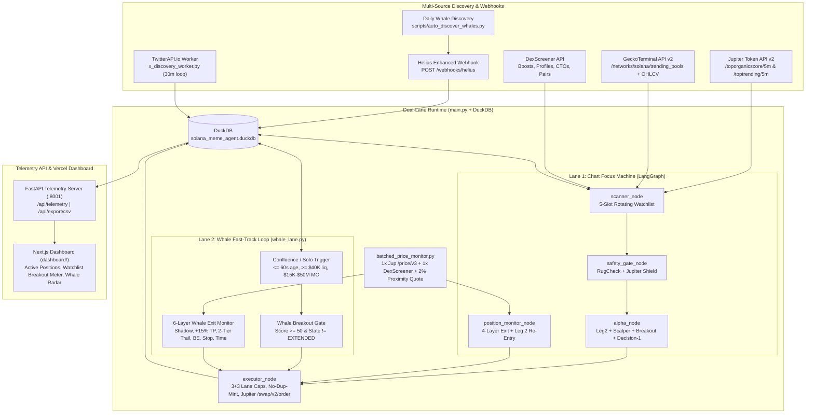
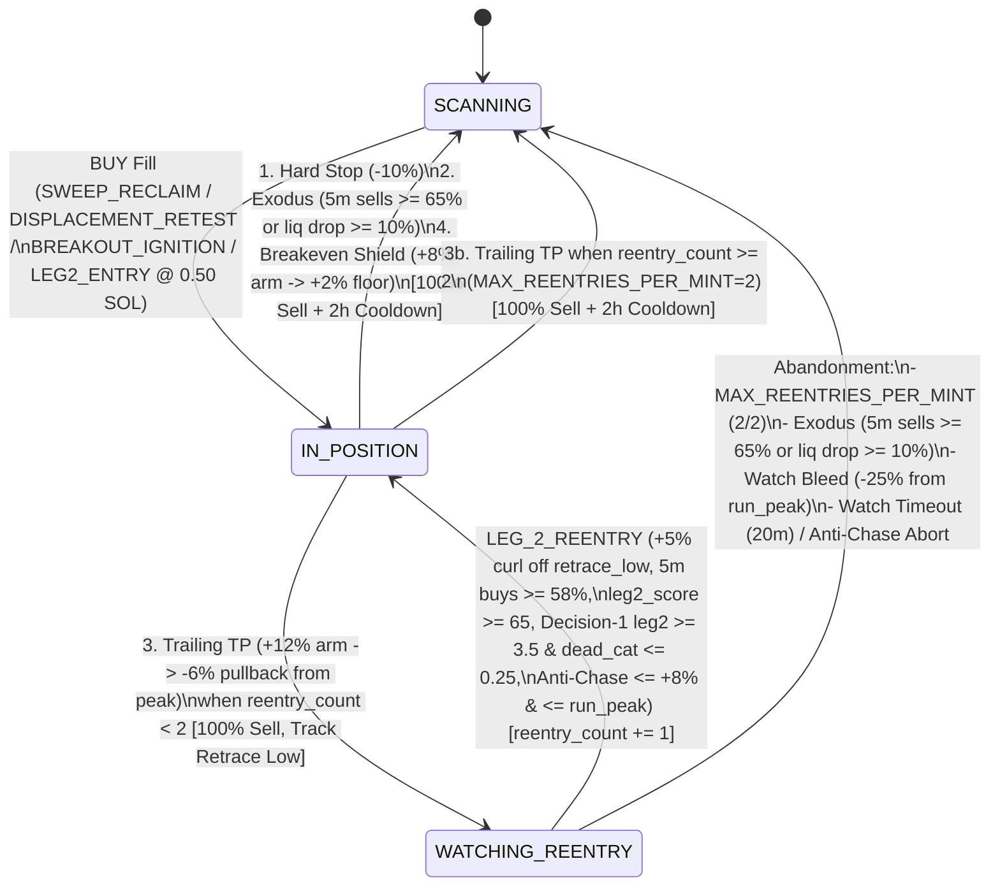

# Solana Autonomous Trading Agent — Complete System Specification (`SPEC.md`)

## 1. Executive Overview & Design Philosophy

`solana-trading-agent` is a deterministic + zero-generation structured-inference autonomous trading system engineered to hunt, evaluate, execute, and risk-manage Solana SPL memecoin setups in real time on low-power edge hardware (Raspberry Pi 5) with a remotely hosted Next.js observability dashboard (Vercel via Cloudflare Tunnel).

### Core Architectural Principles
1. **Zero Generative LLM Hallucinations (`gemini-decision-1` Only)**
   - The agent makes **zero free-form generative text calls**. All qualitative narrative, momentum, copycat/vampire (`is_copycat_vamp`), and dead-cat bounce evaluations are executed through the structured `gemini-decision-1` endpoint (`decision_client.py`) using strict rubric-backed `score` ($0.0\text{--}5.0$), `noul` ($0.0\text{--}1.0$ probability), and `choice` (`BUY` | `WATCH` | `REJECT`) primitives.
   - All trade rationales, gate logs, and telemetry summaries are assembled deterministically in Python.
2. **Deterministic Market-Physics Gatekeeping**
   - `gemini-decision-1` cannot unilaterally trigger a Chart trade. Every candidate must first pass a deterministic **Anti-Cabal Safety Gate** (Jupiter Token API v2 `audit.isSus`, RugCheck summary, and Jupiter Ultra Shield) and the **Scalper Expert Entry Engine** (`SWEEP_RECLAIM`, `DISPLACEMENT_RETEST`, or `BREAKOUT_IGNITION`).
3. **Dual-Lane 3+3 Concurrency (`MAX_CHART_POSITIONS=3`, `MAX_WHALE_POSITIONS=3`, `MAX_OPEN_POSITIONS=6`)**
   - **Lane 1 (`chart_slot` — up to 3 concurrent positions at `0.50 SOL` each):** Executes technical & narrative chart setups (`SWEEP_RECLAIM`, `DISPLACEMENT_RETEST`, `BREAKOUT_IGNITION`, `LEG2_ENTRY`) and `LEG_2_REENTRY` scalps while continuously rotating a **5-Slot Watchlist**.
   - **Lane 2 (`whale_slot` — up to 3 concurrent positions at `0.25 SOL` each):** Operates on an independent 2-second loop (`whale_lane.py`) consuming real-time Helius Enhanced Webhook swap events from a dynamically discovered smart-money roster, gated by the **Whale Breakout Meter & Gate** (`WHALE_MIN_BREAKOUT_SCORE=50`, `WHALE_BLOCK_EXTENDED=true`) and managed by a dedicated **6-Layer Whale Exit Engine**.
4. **Rate-Limit Resilience via Batched Price Polling**
   - Monitoring up to 6 concurrent positions across two lanes uses a single batched Jupiter Price API v3 request (`/price/v3?ids=SOL,mint1,...,mint6`) plus a single batched DexScreener request (`/tokens/v1/solana/...`) per tick (`~12 req/min` total), firing an exact Jupiter Swap Quote (`/swap/v2/order`) **only** on entry, exit execution, or when unrealized PnL approaches within `2.0%` of an active stop, floor, or take-profit threshold.

---

## 2. System Topology & Runtime Loops

### Runtime Coroutines (`main.py`)
When `main.py` starts, it launches four concurrent `asyncio` tasks sharing a thread-safe `AgentDatabase` instance (`solana_meme_agent.duckdb`):
1. **`run_autonomous_loop(config, db)`** — Invokes the compiled LangGraph (`graph.py`). Sleeps `SCAN_POLL_SECONDS` (`15.0s`) in `SCANNING`, `MONITOR_POLL_SECONDS` (`5.0s`) in `IN_POSITION` / `WATCHING_REENTRY`, or `WHALE_MONITOR_POLL_SECONDS` (`2.0s`) if monitoring a legacy whale position.
2. **`run_whale_lane_loop(config, db)`** — Ticks `run_whale_lane_tick()` every `2.0s` when one or more `whale_positions` are open, or every `5.0s` when idle.
3. **`run_x_discovery_loop(config, db)`** *(when `ENABLE_X_DISCOVERY=true`)* — Polls TwitterAPI.io every `X_POLL_INTERVAL_MINUTES` (`30m`) under a strict `X_DAILY_TWEET_CAP` (`1000` tweets/UTC day).
4. **`uvicorn.Server` (`telemetry_api.py`)** — Serves REST endpoints on `0.0.0.0:8001` behind a Cloudflare Tunnel (`https://solana-api.projectkami.net`).

---

## 3. Multi-Source Discovery Funnel (`scanner_node.py`)

Whenever `len(chart_positions) < MAX_CHART_POSITIONS` (`3`) and `len(chart_positions) + len(whale_positions) < MAX_OPEN_POSITIONS` (`6`), `scanner_node` refreshes the **5-Slot Rotating Watchlist** (`MAX_WATCH_BATCH=5`).

### 3.1 Discovery Sources & Priority Ranking
Mints are gathered from five feeds and tagged with a `discovery_source` according to strict priority:

| Priority | Source Tag | Upstream Feed / Mechanism | Cache / TTL |
| :---: | :--- | :--- | :--- |
| **5 (Highest)** | `WHALE` | Active Helius webhook `BUY` signals in `whale_events` (`buy_count >= 1`, `sol_amount >= 0.5 SOL`) | `WHALE_SIGNAL_TTL_MINUTES = 30m` |
| **4** | `X` | Solana base58 contract addresses extracted from X/Twitter (`pump.fun/`, `dexscreener.com/solana/`, or standalone base58 containing digits) | `X_SIGNAL_TTL_MINUTES = 60m` |
| **3** | `JUPITER` | Jupiter Token API v2 `/tokens/v2/toporganicscore/5m` and `/tokens/v2/toptrending/5m` | `JUPITER_POLL_CACHE_SECONDS = 60s` |
| **2** | `GECKO` | GeckoTerminal `/api/v2/networks/solana/trending_pools?include=base_token` | `GECKOTERMINAL_CACHE_SECONDS = 60s` |
| **1** | `DEXSCREENER` | `/token-boosts/latest/v1`, `/token-boosts/top/v1`, `/token-profiles/latest/v1`, `/community-takeovers/latest/v1` | Live per scan tick (`15s`) |

All unique candidate mints (plus currently retained watchlist mints) are batch-queried against DexScreener `/tokens/v1/solana/{mints_csv}` in chunks of 30 and enriched via Jupiter Token API v2 `/tokens/v2/search?query={mints_csv}` in chunks of 100 (`60s` per-mint cache).

### 3.2 Hunting Lane & Hard Pre-Filters (`filter_candidates`)
For each mint, only the **highest-liquidity Solana pool** is selected and filtered against:
- **Not on Cooldown:** `db.is_on_cooldown(mint)` must be `False`.
- **Hunting Lane Bounds (`HUNTING_LANE`):**
  - `momentum_runners` *(default)*:
    - Market Cap: $\text{MIN\_MC\_USD} = \$100,000 \le \text{MC} \le \text{MAX\_MC\_USD} = \$3,000,000$
    - Pair Age: $\text{age\_seconds} \ge \text{MIN\_AGE\_MINUTES} \times 60 = 1800\text{s}$ ($30\text{ minutes}$)
  - `graduations`:
    - Market Cap: $\$50,000 \le \text{MC} \le \$150,000$, no minimum age ($0\text{s}$).
- **Liquidity Floor:** $\text{liquidity\_usd} \ge \text{MIN\_LIQUIDITY\_USD} = \$25,000$
- **1-Hour Volume Floor:** $\text{volume\_1h\_usd} \ge \text{MIN\_VOL\_1H\_USD} = \$30,000$
- **Jupiter Audit Suspicion Guardrail:** Any token where Jupiter Token API v2 reports `audit.isSus == True` is immediately dropped before entering the watchlist.

 surviving candidates are ranked descending by `(volume_1h_usd, boost_amount)` to backfill empty slots in the 5-slot watchlist.

---

## 4. Deterministic Anti-Cabal Safety Gate (`safety_gate_node.py`)

Before `alpha_node` or `whale_lane` can evaluate or buy any token, it must pass `check_token_safety(mint)`. To conserve rate limits, watchlist slots cache `safety_passed = True` in DuckDB once verified, re-running only for newly added watchlist mints or `WHALE_SCALP` triggers.

### 4.1 Three-Layer Safety Verification
1. **Jupiter Token API v2 Audit (`jupiter_token_client.py`):**
   - Rejects if `audit.isSus == True`.
2. **RugCheck Summary (`/v1/tokens/{mint}/report/summary`):**
   - Rejects if `rugged == True`.
   - Rejects if `mintAuthority` or `freezeAuthority` is active (not `null` / empty / `11111111111111111111111111111111`).
   - **Top-10 Holder Concentration:** Sums `pct` across the top 10 holders (`topHolders[:10]`) or parses risk items; rejects if:
     $$\text{top10\_holders\_pct} > \text{MAX\_TOP10\_HOLDERS\_PCT} \quad (20.0\%)$$
   - **LP Lock / Burn Floor:** Takes the maximum `lp.lpLockedPct` across reported markets; rejects if:
     $$\text{lp\_locked\_pct} < \text{MIN\_LP\_LOCKED\_PCT} \quad (95.0\%)$$
   - Rejects on any risk item with `level in ("danger", "critical")`.
3. **Jupiter Ultra Shield (`/ultra/v1/shield?mints={mint}` with `follow_redirects=True`):**
   - Rejects if `isFrozen == True`, active `freezeAuthority`, or active `mintAuthority`.
   - Rejects on any warning with `severity in ("critical", "danger")` or `type` in:
     `{"HAS_MINT_AUTHORITY", "HAS_FREEZE_AUTHORITY", "NOT_SELLABLE", "HONEYPOT", "MUTABLE_TRANSFER_FEES", "HIGH_PRICE_IMPACT", "CRITICAL"}`.
   - **Fail-Closed Policy:** If either RugCheck or Jupiter Shield returns an HTTP error (e.g., `429 Too Many Requests` or timeout), `check_token_safety` fails closed (`passed = False`), evicts the token from the watchlist, logs an `EVICT` (`strategy="SAFETY_GATE"`) row, and places the mint on a **60-minute cooldown** (`SAFETY_REJECT_COOLDOWN_MINUTES=60`).

---

## 5. Mathematical Scoring & Setup Detection Engines

Every watchlist candidate (and every Whale Radar candidate) is scored by two deterministic quantitative engines: the **Leg 2 Predictor** (`leg2_predictor.py`) and the **Scalper Expert Entry Engine + Breakout Ignition Detector** (`scalper_entry_engine.py`, `breakout_ignition.py`).

### 5.1 Deterministic Leg 2 Predictor (`0–100` Points, `leg2_predictor.py`)
`compute_leg2_score()` measures whether a token is absorbing sell pressure and accelerating into a second-leg expansion across 4 additive pillars:

$$\text{Leg2Score} = \text{ clamp}\left(P_{\text{buy}} + P_{\text{vol}} + P_{\text{bounce}} + P_{\text{liq}},\ 0,\ 100\right)$$

1. **Buy Absorption ($P_{\text{buy}} \in [0, 30]$ pts):**
   - Requires 5-minute transaction count $N_{5m} = \text{buys}_{5m} + \text{sells}_{5m} \ge 15$ (otherwise $0$).
   - Let $r_{5m} = \frac{\text{buys}_{5m}}{N_{5m}}$. Scales linearly from $0$ pts at $r_{5m} = 0.50$ to $30$ pts at $r_{5m} \ge 0.62$:
     $$P_{\text{buy}} = 30 \times \text{clamp}\left(\frac{r_{5m} - 0.50}{0.62 - 0.50},\ 0,\ 1\right)$$
2. **Volume Acceleration ($P_{\text{vol}} \in [0, 25]$ pts):**
   - Compares the annualized 5m volume pace against 1h volume:
     $$\text{vol\_accel\_ratio} = \frac{\text{vol}_{5m} \times 12}{\max(\text{vol}_{1h},\ 1.0)}$$
   - Scales linearly to $25$ pts at $\text{vol\_accel\_ratio} \ge 1.30$:
     $$P_{\text{vol}} = 25 \times \text{clamp}\left(\frac{\text{vol\_accel\_ratio}}{1.30},\ 0,\ 1\right)$$
3. **Bounce Structure ($P_{\text{bounce}} \in [0, 25]$ pts):**
   - If $\Delta P_{5m} \le 0\%$, $P_{\text{bounce}} = 0$.
   - Full $25$ pts when $\Delta P_{1h} \ge +15.0\%$ and $\Delta P_{5m} \in [+2.0\%, +25.0\%]$.
   - Otherwise combines:
     - $P_{1h} = 12.5 \times \text{clamp}(\Delta P_{1h} / 15.0,\ 0,\ 1)$
     - $P_{5m} = 12.5$ if $\Delta P_{5m} \in [2\%, 25\%]$; $12.5 \times (\Delta P_{5m}/2.0)$ if $\Delta P_{5m} \in (0\%, 2\%)$; or tapers linearly to $0$ at $\Delta P_{5m} = +50\%$ when overextended above $+25\%$.
     - Plus a $+2.5$ pt structural curl bonus if $\text{peak\_mc} > \text{low\_mc} > 0$ and $\text{mc\_usd} > 1.02 \times \text{low\_mc}$.
4. **Liquidity Depth & Stability ($P_{\text{liq}} \in [0, 20]$ pts):**
   - **Depth ($0\text{--}10$ pts):** $10 \times \text{clamp}\left(\frac{\text{liq\_usd} / \text{mc\_usd}}{0.10},\ 0,\ 1\right)$ (full $10$ pts when liquidity $\ge 10\%$ of Market Cap).
   - **Stability ($0\text{--}10$ pts):** Measures liquidity drop since watchlist entry $\text{drop} = \max\left(0, \frac{\text{entry\_liq} - \text{curr\_liq}}{\text{entry\_liq}}\right)$. Full $10$ pts when $\text{drop} \le 5\%$, tapering linearly to $0$ at $\text{drop} \ge 15\%$.

---

### 5.2 Scalper Expert Entry Engine (`scalper_entry_engine.py`)
Fetches 5-minute OHLCV candles from GeckoTerminal (`ohlcv_client.py`, cached `90s`, paced at `0.35s` with exponential backoff on HTTP 429). If fewer than 12 5m candles exist, it automatically falls back to 1-minute OHLCV candles (`fetch_ohlcv_1m_batch`, requiring $\ge 15$ 1m bars).

#### Technical Indicators
- **Wilder 14-Period RSI (`compute_rsi`):** Standard Wilder smoothing over oldest-first closes ($\text{period}=14$).
- **EMA9 & EMA21 (`compute_ema` / `compute_ema_series`):** Multiplier $k = \frac{2}{\text{period} + 1}$.
- **Rolling 30-Bar VWAP (`compute_vwap`):**
  $$\text{VWAP} = \frac{\sum_{i} \left(\frac{H_i + L_i + C_i}{3}\right) \cdot V_i}{\sum_{i} V_i}$$

#### The Three Valid Chart Setups (Gate 3)
1. **`SWEEP_RECLAIM` (ICT / CRT Liquidity Sweep):**
   - Requires $\ge 6$ 5m candles.
   - Computes the prior 10-candle swing low: $L_{\text{swing}} = \min(L_{-13 \dots -4})$.
   - Triggers when at least one of the last 3 candles wicked below $L_{\text{swing}}$ ($L_k < L_{\text{swing}}$) and closed back above it ($C_k > L_{\text{swing}}$), **and** the latest candle confirms green ($C_{-1} > O_{-1}$) above $L_{\text{swing}}$.
2. **`DISPLACEMENT_RETEST` (Impulse + Controlled Pullback to Midpoint / EMA9):**
   - Requires $\ge 8$ 5m candles and $\text{RSI}_{5m} \in [42.0, 65.0]$.
   - Latest candle must be a green curl closing above the prior candle's high ($C_{-1} > O_{-1}$ and $C_{-1} > H_{-2}$).
   - Scans candles $[-8 \dots -3]$ for a bullish displacement candle $d$ whose body $(C_d - O_d) \ge 1.5 \times \overline{|C - O|}_{\text{prior 10}}$.
   - Subsequent pullback from the post-displacement impulse high $H_{\text{imp}}$ to pullback low $L_{\text{pb}}$ must be a controlled $10\%\text{--}30\%$ retrace ($0.10 \le \frac{H_{\text{imp}} - L_{\text{pb}}}{H_{\text{imp}}} \le 0.30$) that tags within $+3\%$ of the displacement body midpoint $\frac{O_d + C_d}{2}$ or $\text{EMA}_9$.
3. **`BREAKOUT_IGNITION` (`breakout_ignition.py` — 5m Primary or 1m Fallback):**
   - Designed to capture fresh consolidation breakouts that traditional pullback rules block (bypasses the `< 5%` near-1h-high block and allows $\text{RSI} \le 78.0$).
   - Evaluated across **5 weighted pillars (`0–100` Breakout Score)**:

| Pillar | Max Points | Full-Credit Rule & Partial-Credit Rule | Failure Gate Tag |
| :--- | :---: | :--- | :--- |
| **1. Coil / Base** | **20 pts** | Prior 3–4 bars (`candles[-5:-1]`) have tight range $\frac{H_{\text{coil}} - L_{\text{coil}}}{L_{\text{coil}}} \le 8.0\%$ **OR** 3 consecutive higher lows ($L_{-4} \le L_{-3} \le L_{-2}$ with $L_{-2} > L_{-4}$). *(Partial: +10 pts if range $\le 12.0\%$)* | `COIL(X.X%>8.0%)` |
| **2. Resistance Break & Body Conviction** | **25 pts** | Latest candle is green ($C_{-1} > O_{-1}$), closes above the prior 15m–30m swing high ($6$ bars on 5m, up to $30$ bars on 1m), **AND** closes in the top $35\%$ of its range ($\frac{C_{-1} - L_{-1}}{H_{-1} - L_{-1}} \ge 0.65$). *(Partial: +12 pts if close breaks swing high but body $< 65\%$)* | `RES(no_break)` or `RES_BODY(XX%<65%)` |
| **3. Volume & Order-Flow Spike** | **25 pts** | Split into 3 sub-gates: • **Volume Spike (10 pts):** $V_{-1} / \overline{V}_{-6 \dots -2} \ge 2.0\text{x}$ *(+5 pts if $\ge 1.5\text{x}$)* • **5m Buy Ratio (8 pts):** $\text{buy\_ratio}_{5m} \ge 62\%$ *(+4 pts if $\ge 55\%$)* • **5m Buy Acceleration (7 pts):** $\frac{\text{buys}_{5m}}{\text{buys}_{1h} / 12} \ge 1.5\text{x}$ *(+3 pts if $\ge 1.2\text{x}$)* | `VOL_SPIKE(X.Xx<2.0x)` `BUY_RATIO(XX%<62%)` `BUY_ACCEL(X.Xx<1.5x)` |
| **4. MA / VWAP / RSI Alignment** | **15 pts** | Split into 3 sub-gates ($5$ pts each): • **EMA (5 pts):** $\text{EMA}_9 > \text{EMA}_{21}$ and $\text{EMA}_9[-1] > \text{EMA}_9[-2]$ • **VWAP (5 pts):** $C_{-1} > \text{VWAP}_{30}$ • **RSI (5 pts):** $\text{RSI}_{14} \le 78.0$ | `EMA(not_aligned)` `VWAP(below)` `RSI(XX.X>78)` |
| **5. HTF 15m Context & Anti-Chase** | **15 pts** | Split into 2 sub-gates: • **15m HTF Bullish (7 pts):** Aggregated 15m bars show $C_{-1} > \text{EMA}_{21,15m}$ or a green higher-low 15m bar • **Anti-Chase Extension (8 pts):** Price is $\le +12.0\%$ above **both** $\text{EMA}_9$ and $\text{VWAP}$ | `HTF_15M(bearish)` `EXT(+XX.X%>+12%)` |

#### Breakout Meter State Classification
Every evaluation produces a `BreakoutTelemetry` object with:
- `state = "EXTENDED"` if extension above $\text{EMA}_9$ or $\text{VWAP}$ exceeds $+12.0\%$ (regardless of score)
- `state = "IGNITION"` if not extended and $\text{score} \ge 75$
- `state = "COILING"` if not extended and $50 \le \text{score} \le 74$
- `state = "FORMING"` if not extended and $\text{score} < 50$

#### All 4 Deterministic Gates of `evaluate_scalper_entry`
For `scalper.eligible` to be `True`:
1. **Gate 1 (Mandatory Soak):** `time_in_slot_min >= MIN_WATCHLIST_SOAK_MINUTES` (`3.0m` default; note: configurable in `.env`).
2. **Gate 2 (Anti-Chase & RSI Cooling):**
   - For `SWEEP_RECLAIM` / `DISPLACEMENT_RETEST`: $\text{RSI}_{5m} \le 70.0$ (`SCALPER_MAX_RSI_5M`) **and** $\text{dist\_from\_1h\_high\_pct} = \frac{H_{1h} - P}{H_{1h}} \ge 5.0\%$ (`ANTI_CHASE_HIGH_BUFFER_PCT=0.05`).
   - For `BREAKOUT_IGNITION`: bypasses `dist_from_1h_high_pct < 5%` (since breakouts occur at highs, guarded instead by the $\le +12\%$ EMA9/VWAP cap) and allows $\text{RSI} \le 78.0$.
3. **Gate 3 (Valid Setup):** `setup_type in {"SWEEP_RECLAIM", "DISPLACEMENT_RETEST", "BREAKOUT_IGNITION"}`.
4. **Gate 4 (Order-Flow Imbalance):** $\text{txns}_{5m} \ge 15$ (`SCALPER_MIN_TXNS_5M`) and $\text{buy\_ratio}_{5m} \ge 58\%$ (`SCALPER_MIN_BUY_RATIO_5M`, or $\ge 62\%$ for `BREAKOUT_IGNITION`).

---

## 6. Pure Decision-1 Strategist & Watchlist Eviction Mechanics (`alpha_node.py`)

### 6.1 Single Batched `gemini-decision-1` Call
On each scan tick, all `safe_candidates` in the 5-slot watchlist are packed into a single batched prompt (`_build_batch_entry_prompt`) containing:
- Market Cap, Liquidity, 1h & 5m Volume, 5m & 1h Price Change %, 5m Buys/Sells & Buy Ratio, Pair Age, DexScreener Boosts
- Full `leg2_predictor` summary (`score/100` + 4-pillar breakdown)
- `scalper_setup`, `rsi_5m`, `dist_from_1h_high`, `scalper_eligible`
- Jupiter Token v2 `organic_score`, `is_verified`, `holder_count`, `top_holders_pct`
- Active X/Twitter social signals (`x_mentions`, `x_unique_authors`, `x_total_likes`, top 5 author snippets)
- Active Helius Whale signals (`whale_buy_count`, `whale_unique_wallets`, `whale_total_sol_spent`, `whale_sell_count`)

For each token $i \in \{0 \dots k-1\}$, `gemini-decision-1` answers 4 structured questions:
1. `t{i}_narrative_strength` (`score` $0\text{--}5$)
2. `t{i}_momentum_quality` (`score` $0\text{--}5$)
3. `t{i}_is_copycat_vamp` (`noul` $0.0\text{--}1.0$)
4. `t{i}_action` (`choice` $\in \{\text{BUY}, \text{WATCH}, \text{REJECT}\}$ with `confidence` $\in [0.0, 1.0]$)

### 6.2 Dual Approval Paths (Gated by `scalper.eligible`)
A candidate is approved for entry (`approved = decision1_wants_buy and scalper.eligible`) if `scalper.eligible` is `True` and either:

1. **Path A — Standard Decision-1 Approval (`standard_approved`):**
   - `action == "BUY"`
   - `action_confidence >= MIN_BUY_CONFIDENCE` (`0.60`)
   - `is_copycat_vamp <= MAX_VAMP_ENTRY` (`0.55`)
   - `narrative_strength >= MIN_NARRATIVE_SCORE` (`2.5` / 5.0)
   - `momentum_quality >= MIN_MOMENTUM_SCORE` (`3.0` / 5.0)
   - Logged with `strategy = scalper.setup_type` (`SWEEP_RECLAIM`, `DISPLACEMENT_RETEST`, or `BREAKOUT_IGNITION`) and `reason = "DECISION_1_ENTRY"`.
2. **Path B — Leg 2 Fast-Track Approval (`leg2_fast_track`):**
   - `leg2_score >= LEG2_FAST_TRACK_MIN_SCORE` (`70.0` / 100)
   - `is_copycat_vamp <= MAX_VAMP_ENTRY` (`0.55`)
   - `momentum_quality >= LEG2_FAST_TRACK_MIN_MOM` (`2.8` / 5.0)
   - Either (`action == "BUY"` and `action_confidence >= 0.55`) **OR** (`action == "WATCH"` and `leg2_score >= 80.0`)
   - Logged with `strategy = "LEG2_ENTRY"` and `reason = "LEG2_ENTRY"`.

If multiple watchlist tokens are approved on the same tick, `alpha_node` ranks them by:
$$\text{RankKey} = \left(\text{narrative\_strength} + \text{momentum\_quality} + \frac{\text{leg2\_score}}{25.0},\ \text{action\_confidence},\ -\text{is\_copycat\_vamp}\right)$$
and emits a `PendingOrder` (`side="BUY"`, `0.50 SOL`) for the top-ranked non-duplicate mint.

### 6.3 Watchlist Retention & Eviction Rules
If a token is **not** entered on the current tick:
- **Blocked by Scalper Gate (`decision1_wants_buy == True` and `scalper.eligible == False`):**
  - **Retained in watchlist** (`vamp_strikes` reset to `0`) so it can finish soaking or complete its chart setup on subsequent ticks.
  - Logged to `action_log` as `action="DECISION_1"`, `reason="BLOCKED: <exact failed gates>"`.
- **Eviction Rule 1 — High Copycat/Vamp Score (Jitter-Resistant):**
  - Immediate eviction if `is_copycat_vamp >= VAMP_EVICT_THRESHOLD` (`0.85`).
  - Two-strike eviction (`CONSECUTIVE_VAMP`) if `is_copycat_vamp >= VAMP_WARN_THRESHOLD` (`0.75`) for `VAMP_CONSECUTIVE_STRIKES` (`2`) consecutive ticks.
  - Sets a **20-minute cooldown** (`VAMP_DROP_COOLDOWN_MINUTES=20`).
- **Eviction Rule 2 — Weak Narrative AND Weak Momentum (`LOW_SCORE`):**
  - Triggers when **both** `narrative_strength < 2.0` **and** `momentum_quality < 2.0` (`LOW_SCORE_EVICT_THRESHOLD=2.0`).
  - **Coiling Base Grace Strike:** If the token is a coiling base ($\text{liquidity\_usd} \ge \$40,000$, $\text{is\_copycat\_vamp} < 0.65$, and $\text{dist\_from\_1h\_high\_pct} \le 5\%$), it is granted 1 grace strike (`1/2`) and only evicted on 2 consecutive `LOW_SCORE` ticks.
  - Sets a **15-minute cooldown** (`LOW_SCORE_COOLDOWN_MINUTES=15`).
- **Eviction Rule 3 — Stale Watchlist Timeout (`STALE_WATCH`):**
  - Standard watchlist slots expire after `STALE_WATCH_TIMEOUT_MINUTES = 15m`.
  - Coiling base tokens receive an extended timeout of **25 minutes**.
  - Sets a **10-minute cooldown** (`STALE_WATCH_COOLDOWN_MINUTES=10`).

---

## 7. Lane 1 (Chart Slot) Position Management & Leg 2 Re-Entry (`position_monitor_node.py`)

### 7.1 Four-Layer Chart Exit Engine (`IN_POSITION`)
Evaluated in strict priority order on every monitor tick (`5.0s`):

1. **Layer 1 — Hard Stop Loss (`-10.0%`):**
   - Triggers when $\text{pnl\_pct} \le -\text{HARD\_STOP\_LOSS\_PCT}$ (`-0.10`).
   - Sells 100% of tokens, transitions to `SCANNING`, and applies a **2-hour cooldown** (`COOLDOWN_HOURS=2.0`).
2. **Layer 2 — Order-Flow / Liquidity Exodus (`EXODUS_SELL_FLOW` / `EXODUS_LIQ_DROP`):**
   - Triggers immediately (even before `-10%` price impact) if:
     - 5-minute sell ratio $\frac{\text{sells}_{5m}}{\text{buys}_{5m} + \text{sells}_{5m}} \ge \text{EXODUS\_SELL\_RATIO}$ (`65%`), **OR**
     - Pool liquidity drops $\frac{\text{entry\_liq} - \text{curr\_liq}}{\text{entry\_liq}} \ge \text{EXODUS\_LIQ\_DROP\_PCT}$ (`10%`).
   - Sells 100% of tokens, transitions to `SCANNING`, and applies a **2-hour cooldown**.
3. **Layer 3 — Trailing Take-Profit (`+12.0%` Arm $\rightarrow$ `-6.0%` Pullback from Peak):**
   - Arms (`pos.trail_armed = True`) as soon as $\text{peak\_pnl\_pct} \ge \text{TRAIL\_ARM\_PCT}$ (`+12.0%`).
   - Triggers when SOL value pulls back $\frac{\text{peak\_sol} - \text{curr\_sol}}{\text{peak\_sol}} \ge \text{TRAIL\_PULLBACK\_PCT}$ (`6.0%`) from `peak_sol_value`.
   - Sells 100% of tokens:
     - If `pos.reentry_count < MAX_REENTRIES_PER_MINT` (`2`), transitions to **`WATCHING_REENTRY`** (preserving `run_peak_sol`, `retrace_low_sol`, `reference_token_amount`, and `reentry_count`).
     - If `pos.reentry_count >= 2`, transitions directly to **`SCANNING`** with a **2-hour cooldown** so exhausted pumps are not over-traded.
4. **Layer 4 — Breakeven Shield (`+8.0%` Arm $\rightarrow$ `+2.0%` Floor):**
   - Arms (`pos.breakeven_armed = True`) once $\text{peak\_pnl\_pct} \ge \text{BREAKEVEN\_ARM\_PCT}$ (`+8.0%`).
   - Triggers if $\text{pnl\_pct}$ falls back to or below `BREAKEVEN_FLOOR_PCT` (`+2.0%`), locking in a green trade to cover DEX fees/slippage.
   - Sells 100% of tokens, transitions to `SCANNING`, and applies a **2-hour cooldown**.

### 7.2 `WATCHING_REENTRY` & Anti-Chase Guarded Leg 2 Re-Entry
While in `WATCHING_REENTRY`, the agent tracks the post-exit lowest SOL quote (`retrace_low_sol`) for the sold token quantity (`reference_token_amount`).
- **Four Abandonment Conditions (each applies a 2-hour cooldown and returns to `SCANNING`):**
  1. `pos.reentry_count >= MAX_REENTRIES_PER_MINT` (`2`, capping total legs per token at 3 trades).
  2. **Exodus:** 5m sell ratio $\ge 65\%$ or liquidity drop $\ge 10\%$.
  3. **Deep Bleed (`WATCH_BLEED`):** Drawdown from `run_peak_sol` reaches $\frac{\text{run\_peak} - \text{curr\_sol}}{\text{run\_peak}} \ge \text{WATCH\_MAX\_BLEED\_PCT}$ (`25.0%`).
  4. **Watch Timeout (`WATCH_TIMEOUT`):** Elapsed time in `WATCHING_REENTRY` reaches `WATCH_TIMEOUT_MINUTES` (`20m`).
- **Leg 2 Re-Entry Trigger & Anti-Chase Re-Quote:**
  1. **Quantitative Trigger:**
     - Curl off `retrace_low_sol`: $\text{curl\_pct} = \frac{\text{curr\_sol} - \text{retrace\_low}}{\text{retrace\_low}} \ge \text{REENTRY\_CURL\_PCT}$ (`+5.0%`)
     - 5-minute buy ratio $\ge \text{REENTRY\_MIN\_BUY\_RATIO}$ (`58%`)
     - Deterministic `compute_leg2_score()` $\ge \text{REENTRY\_MIN\_LEG2\_PREDICTOR\_SCORE}$ (`65.0` / 100)
     - Free SOL balance $\ge \text{TRADE\_SIZE\_SOL}$ (`0.50 SOL`)
  2. **Decision-1 Confirmation (`evaluate_leg2_reentry`):**
     - Queries `gemini-decision-1` for `leg_2_momentum` (`score` $0\text{--}5$) and `is_dead_cat_bounce` (`noul` $0\text{--}1$).
     - Requires `leg_2_momentum >= REENTRY_MIN_LEG2_SCORE` (`3.5`) and `is_dead_cat_bounce <= REENTRY_MAX_DEAD_CAT` (`0.25`).
  3. **Live Anti-Chase Guard (`MAX_REENTRY_CHASE_PCT = 0.08`):**
     - Immediately after Decision-1 responds, `position_monitor_node` fires a fresh Jupiter Swap Quote (`live_sol_value`) and compares it against `curl_trigger_sol` (the quote before Decision-1 latency) and `run_peak_sol`.
     - If $\frac{\text{live\_sol\_value} - \text{curl\_trigger\_sol}}{\text{curl\_trigger\_sol}} > +8.0\%$ **OR** $\text{live\_sol\_value} > \text{run\_peak\_sol}$, the re-entry is **aborted** (`REENTRY_ANTI_CHASE_ABORT`), the mint is placed on a 2-hour cooldown, and the agent returns to `SCANNING` rather than buying a vertical top.

---

## 8. Lane 2 (Whale Slot): Helius Whale Radar, Auto-Discovery & `WHALE_SCALP`

### 8.1 Automated Daily Smart-Money Discovery (`scripts/auto_discover_whales.py` & `whale_discovery_scoring.py`)
Run daily at `04:00 UTC` via `systemd` (`deploy/whale-discovery.timer` & `deploy/whale-discovery.service`) with a `HeliusEnhancedPacer` (`helius_pacer.py`, `0.6s` minimum interval + exponential backoff on HTTP 429):

1. **Stage 1a — Runner Pool Harvesting (`fetch_runner_pools`):**
   - Queries DexScreener `/token-boosts/top/v1`, `/token-boosts/latest/v1`, `/token-profiles/latest/v1`, plus organic search `/latest/dex/search?q=SOL` and `?q=pump`.
   - Filters to Solana pools with $\text{liquidity\_usd} \ge \$25,000$, $\text{volume\_24h} \ge \$100,000$, and $\$100,000 \le \text{MC} \le \$50,000,000$ (both green runners and red accumulation dips), selecting the top **18 pools** by 24h volume.
2. **Stage 1b — Swap Buyer Extraction (`extract_buyer_candidates`):**
   - Pulls up to 2 pages (`200` SWAP transactions) per pool from Helius `/v0/addresses/{pair}/transactions?type=SWAP`.
   - Computes true SOL swap size across `nativeTransfers`, Wrapped SOL (`So1111...1112`) `tokenTransfers`, and `events.swap.nativeInput`/`nativeOutput` (`_extract_sol_delta_for_wallet`), extracting up to **40 unique `feePayer` buyer wallets** with buy size $\ge 1.0\text{ SOL}$ (excluding known DEX/AMM/router programs and already-pinned wallets).
3. **Stage 2 — 7-Day Human & Edge Scoring (`score_wallet_history`):**
   - Pre-filters liquid SOL balance via Solana RPC `getBalance` ($\ge 5.0\text{ SOL}$ required before fetching 7d history).
   - Pulls up to 500 transactions over 7 days and enforces **8 anti-bot / anti-insider / profitability filters**:
     - `NO_SLEEP_GAP`: Must have $\ge 3$ consecutive UTC hours with 0 trades (`max_consecutive_zero_hours >= 3`), rejecting 24/7 automated bots.
     - `GHOST_WALLET` / `SPAM_BOT`: 7-day transaction count must be within $[25,\ 1500]$.
     - `DEPLOYER_DUMPER`: Rejects if $\text{sell\_count} > 3 \times \text{buy\_count}$ (allowing human traders who scale out in 2–3 ladder sells per buy).
     - `SERIAL_MINTER`: Rejects if token creation transactions (`TOKEN_MINT`, `CREATE`, `INITIALIZE_MINT`) $> 10$.
     - `LOW_AMMO`: Liquid balance $< 5.0\text{ SOL}$.
     - `LOW_WIN_RATE`: Closed-mint win rate $< 45\%$.
     - `LOW_REALIZED_PNL`: 7-day realized SOL PnL $< +3.0\text{ SOL}$.
     - `ONE_HIT_WONDER`: Requires $\ge 2$ distinct winning mints (`winning_mints >= 2`) **and** top single mint share $\le 85\%$ of net/gross realized profit.
   - Passing wallets are ranked by:
     $$\text{rank\_score} = \text{win\_rate} \times \ln\left(1 + \max(0,\ \text{realized\_sol\_pnl})\right)$$
   - Merges the top discovered wallets with pinned wallets (`HELIUS_TRACKED_WALLETS`, capped at 25 total) and atomically updates the Helius webhook via a single `PUT /v0/webhooks/{HELIUS_WEBHOOK_ID}` call (skipping the `PUT` if the sorted address set is unchanged).

### 8.2 Real-Time Webhook Ingestion (`helius_webhook.py`)
- **`POST /webhooks/helius`:** Verifies `Authorization` header in constant time (`hmac.compare_digest`), parses `SWAP` transactions for wallets in the dynamically synced Helius roster (`fetch_helius_tracked_wallets`, 5-minute cache with detail endpoint hydration `GET /v0/webhooks/{id}`), filters out dust buys ($< 0.5\text{ SOL}$), deduplicates by transaction `signature` in `whale_events`, and logs a `WHALE_WEBHOOK` row (`WHALE_BUY` or `WHALE_SELL`) to `action_log`.
- **Instant Shadow Exit Flagging:** If a tracked whale **sells** a mint currently held in any of the 3 `whale_positions` (or a legacy `WHALE_SCALP` position) and that wallet was one of the `triggering_wallets` for that position, `db.flag_whale_shadow_exit(mint, wallet)` immediately sets `whale_shadow_exit_flag = True` on that slot.

### 8.3 `WHALE_SCALP` Entry Pipeline & Whale Breakout Gate (`whale_lane.py`)
Every 2–5 seconds, `run_whale_lane_tick()` checks for open capacity (`len(whale_positions) < MAX_WHALE_POSITIONS` (`3`) and total open `< 6`), checks the global daily circuit breaker and free SOL ($\ge 0.25\text{ SOL}$), and queries `db.get_whale_fast_track_triggers()`:

1. **Trigger Qualification (`<= 60s` signal age within a 5-minute window):**
   - **`CONFLUENCE` Trigger:** $\ge 2$ unique tracked whales (`WHALE_MIN_UNIQUE_WALLETS=2`) bought the mint within the last 5 minutes, with the latest buy $\le 60\text{s}$ old (`WHALE_ENTRY_MAX_AGE_SECONDS=60`).
   - **`SOLO` Trigger:** $1$ tracked whale bought $\ge 1.5\text{ SOL}$ (`WHALE_MIN_SOLO_BUY_SOL=1.5`) within the last $60\text{s}$.
2. **Pre-Entry Guards:**
   - Mint is not on cooldown and not already open in any Chart or Whale slot (`db.get_all_open_mints()`).
   - Jupiter Token API v2 `audit.isSus` is not `True`.
   - DexScreener pool liquidity $\ge \$40,000$ (`WHALE_MIN_LIQUIDITY_USD=40000`).
   - Market Cap is within $[\$15,000,\ \$50,000,000]$ (`WHALE_MIN_MCAP_USD` to `WHALE_MAX_MCAP_USD`).
3. **Whale Breakout Meter & Gate (`WHALE_MIN_BREAKOUT_SCORE=50`, `WHALE_BLOCK_EXTENDED=true`):**
   - Fetches 5m OHLCV candles (plus 1m fallback candles if $< 12$ 5m bars exist) and runs `evaluate_scalper_entry()` to compute `breakout_telemetry` (`score`, `state`, `timeframe`, `vol_ratio`, `ema_ext_pct`, `passed_gates`, `failed_gates`).
   - **Blocks entry** if `state == "EXTENDED"` (when `WHALE_BLOCK_EXTENDED=true`, i.e., price is $> +12\%$ above EMA9 or VWAP) **or** if `score < WHALE_MIN_BREAKOUT_SCORE` (`50`), persisting the exact failed gates (`BREAKOUT_EXTENDED (...)` or `BREAKOUT_SCORE(35<50): ...`) to `whale_decisions` and `action_log` (`WHALE_CONFLUENCE`).
   - **Tags Breakout Confluence:** If `state == "IGNITION"` ($\text{score} \ge 75$), the entry reason is upgraded to `WHALE_BREAKOUT_CONFLUENCE` (otherwise `WHALE_SCALP_CONFLUENCE` or `WHALE_SCALP_SOLO`).
4. **Safety Gate & Execution:**
   - Runs full `check_token_safety()` (RugCheck + Jupiter Shield).
   - Emits a `0.25 SOL` `BUY` `PendingOrder` (`slot="whale_slot"`, `strategy="WHALE_SCALP"`) carrying `breakout_telemetry`, `triggering_wallets`, `entry_mc_usd`, and `whale_sol_flow` into `executor_node`.

### 8.4 Six-Layer `WHALE_SCALP` Exit Engine (`evaluate_whale_exit_order`)
Evaluated in strict priority order every `2.0s` for each open position in `whale_positions`:

| Priority | Exit Layer | Trigger Condition | Cooldown |
| :---: | :--- | :--- | :---: |
| **1** | **`WHALE_SHADOW_EXIT`** | Any `triggering_wallet` that triggered the entry executes a `SELL` on Helius webhook (`pos.whale_shadow_exit_flag == True`) | `2.0h` |
| **2** | **`WHALE_FRONT_RUN_TP`** | Unrealized PnL reaches $+\text{WHALE\_TP\_PCT}$ (`+15.0%`) | `2.0h` |
| **3** | **`WHALE_PEAK_TRAIL` (2-Tier)** | • **Tier 1:** Arms at `+8.0%` (`WHALE_TRAIL_ARM_PCT`); exits on a `-3.5%` drop from `peak_sol_value` (`WHALE_TRAIL_DROP_PCT`). • **Tier 2 (Tight):** Once peak PnL reaches `+12.0%` (`WHALE_TIGHT_TRAIL_ARM_PCT`), tightens allowed drop from peak to `-2.5%` (`WHALE_TIGHT_TRAIL_DROP_PCT`). | `2.0h` |
| **4** | **`WHALE_BREAKEVEN_SHIELD`** | Arms once peak PnL reaches `+5.0%` (`WHALE_BREAKEVEN_ARM_PCT`); exits if PnL falls back to or below `+1.0%` (`WHALE_BREAKEVEN_FLOOR_PCT`). | `2.0h` |
| **5** | **`WHALE_HARD_STOP`** | Unrealized PnL reaches $\le \text{WHALE\_HARD\_STOP\_PCT}$ (`-10.0%`) | `2.0h` |
| **6** | **`WHALE_TIME_STOP`** | Held $\ge \text{WHALE\_TIME\_STOP\_SECONDS}$ (`300s` / 5 min) with unrealized PnL $< +4.0\%$ (`WHALE_TIME_STOP_MIN_PNL_PCT`) | `2.0h` |

---

## 9. Batched Price Polling & On-Demand Jupiter Swap Quotes (`batched_price_monitor.py`)

To support up to 6 concurrent positions without triggering HTTP 429 rate limits on Jupiter's Swap Quote API:
1. **`fetch_batched_sol_prices(mints)`:**
   - Makes **1 batched call** to `GET https://api.jup.ag/price/v3?ids=So1111...1112,{mints_csv}` to compute USD-derived SOL price per token ($\text{tok\_usd} / \text{sol\_usd}$).
   - Makes **1 batched call** to `GET https://api.dexscreener.com/tokens/v1/solana/{mints_csv}` to fetch 5m order flow (`buys_5m`, `sells_5m`), pool liquidity, and fallback `priceNative`.
   - Applies per-endpoint exponential backoff ($5\text{s} \times 2^{n-1}$, capped at $120\text{s}$) on HTTP `429` without evicting positions.
2. **`needs_exact_jupiter_quote(pos, estimated_sol_value, proximity_pct=2.0)`:**
   - Only fires an individual `GET /swap/v2/order` quote (`resolve_position_sol_value`) when estimated PnL is within **`2.0%`** of any active exit threshold:
     - **Chart Slot:** $\text{PnL} \le -8.0\%$ (within $2\%$ of $-10\%$ Hard Stop), armed Breakeven Shield with $\text{PnL} \le +4.0\%$ (within $2\%$ of $+2\%$ floor), or armed Trailing TP with pullback from peak $\ge 4.0\%$ (within $2\%$ of $6\%$ pullback).
     - **Whale Slot:** `whale_shadow_exit_flag == True`, $\text{PnL} \le -8.0\%$, $\text{PnL} \ge +13.0\%$ (within $2\%$ of $+15\%$ TP), armed Whale BE Shield with $\text{PnL} \le +3.0\%$, armed 2-Tier Peak Trail within $2\%$ of drop limit ($\ge 1.5\%$ drop on Tier 1 or $\ge 0.5\%$ drop on Tier 2), or within $10\text{s}$ of the $300\text{s}$ Time Stop with $\text{PnL} < +6.0\%$.

---

## 10. Execution Engine & Global Risk Controls (`executor_node.py`)

Every `BUY`, `REENTRY_BUY`, and `SELL` across both lanes passes through `executor_node`:

1. **Pre-Trade Shared Safety Guards (on `BUY`):**
   - **No Duplicate Mints Across Lanes:** Queries `db.get_all_open_mints()` plus in-memory `chart_positions`, `whale_positions`, `active_position`, and `whale_position`. Blocks any `BUY` if the mint is already open in either lane (except a valid same-mint `LEG_2_REENTRY` transitioning from `WATCHING_REENTRY` to `IN_POSITION` in `chart_slot`).
   - **3+3 Lane & Global Capacity Caps:** Blocks if `len(chart_positions) >= MAX_CHART_POSITIONS` (`3`), `len(whale_positions) >= MAX_WHALE_POSITIONS` (`3`), or `len(chart_positions) + len(whale_positions) >= MAX_OPEN_POSITIONS` (`6`).
   - **Free SOL Balance Guard:** Verifies `sol_balance >= order.amount_atomic / 1e9`.
2. **Global Daily Max Loss Circuit Breaker (`DAILY_MAX_LOSS_PCT = 0.20`):**
   - Both lanes share `sol_balance`, `daily_start_sol` (auto-rolled over at `00:00 UTC`), and `daily_pnl_sol`.
   - If $\frac{-\text{daily\_pnl\_sol}}{\text{daily\_start\_sol}} \ge 20.0\%$, both `scanner_node` and `run_whale_lane_tick` halt new entries for the remainder of the UTC day and log a single `CIRCUIT_BREAKER` event to `action_log`.
3. **Paper vs. Live Jupiter Swap V2 Execution:**
   - **Paper Mode (`EXECUTION_MODE="paper"`):** Calls `GET https://api.jup.ag/swap/v2/order` **without** a `taker` parameter to obtain a real market route quote (`outAmount`), simulates fill at the exact quoted atomic amount, and assigns signature `PAPER-{side}-{mint[:8]}`.
   - **Live Mode (`EXECUTION_MODE="live"`):** Calls `GET /swap/v2/order` with `taker=str(keypair.pubkey())`, deserializes the base64 `VersionedTransaction`, signs with `Keypair.from_base58_string(SOLANA_PRIVATE_KEY_BS58)`, and broadcasts via `POST /swap/v2/execute`.

---

## 11. DuckDB Persistence & 36-Column Full-Board CSV Schema (`db.py`, `action_export.py`)

### 11.1 Core DuckDB Tables (`solana_meme_agent.duckdb`)
1. **`agent_state` (Singleton `id = 1`):** `focus_state`, `sol_balance`, `daily_start_sol`, `daily_pnl_sol`, `daily_reset_date`, `active_position_json`, `whale_position_json`, `chart_positions_json`, `whale_positions_json`, `strategy`, `triggering_wallets_json`, `whale_shadow_exit_requested`, `last_decision_rationale`, `updated_at`.
2. **`active_watchlist` (5-Slot Rotating State):** `mint`, `symbol`, `pair_address`, `added_at`, `safety_passed`, `vamp_strikes`, `entry_liquidity_usd`, `peak_mc`, `low_mc`, `leg2_score`, `leg2_breakdown_json`, `rsi_5m`, `setup_type`, `scalper_eligible`, `dist_from_1h_high_pct`, `discovery_source`, `jup_organic_score`, `jup_meta_json`, `last_evaluated_at`, `latest_scores_json`, `candidate_json`.
3. **`cooldowns`:** `mint`, `expires_at`, `reason`.
4. **`whale_events`:** `signature` (PK), `wallet`, `mint`, `side`, `sol_amount`, `token_amount`, `timestamp_utc`.
5. **`whale_decisions`:** `mint` (PK), `status` (`ENTERED` | `SKIPPED`), `reason`, `updated_at`, `breakout_telemetry_json`.
6. **`social_signals` & `x_seen_tweets` & `x_poll_meta`:** Persists deduplicated X tweets, extracted mints, author/like counts, and daily quota counters.
7. **`decision_log` & `trade_log`:** Structured audit trail of Decision-1 evaluations and swap executions.
8. **`action_log` (36-Column Full-Board Telemetry Ledger):** Exported via `GET /api/export/csv` (supports `?type=all|trades|whales|watchlist`, `?actions=BUY,SELL,...`, `?strategy=...`, `?limit=...`).

### 11.2 Complete 36-Column `solana_actions.csv` Schema
| # | Column | Type | Populated On / Description |
| :---: | :--- | :--- | :--- |
| 1–4 | `timestamp_utc`, `bot`, `mode`, `action` | `VARCHAR` | ISO-8601 UTC timestamp, `"solana_meme"`, `"paper"`/`"live"`, and action (`DECISION_1`, `EVICT`, `BUY`, `SELL`, `REENTRY_BUY`, `WHALE_WEBHOOK`, `WHALE_CONFLUENCE`, `WHALE_DISCOVERY`, `CIRCUIT_BREAKER`) |
| 5–10 | `symbol`, `asset_id`, `qty`, `notional`, `unit`, `price_or_value` | `VARCHAR` / `DOUBLE` | Token symbol, SPL mint address, token quantity, SOL notional, `"SOL"`, and SOL value/price |
| 11–14 | `pnl_amount`, `pnl_pct`, `strategy`, `reason` | `DOUBLE` / `VARCHAR` | Realized SOL PnL and `%` (on `SELL` / `CIRCUIT_BREAKER`), strategy (`SWEEP_RECLAIM`, `DISPLACEMENT_RETEST`, `BREAKOUT_IGNITION`, `LEG2_ENTRY`, `WHALE_SCALP`, `WHALE_RADAR`, `NONE`, etc.), and detailed decision/exit reason |
| 15–17 | `sol_equity`, `daily_realized_sol`, `circuit_breaker` | `DOUBLE` / `BOOL` | Auto-injected live total SOL equity (`sol_balance + open positions`), daily realized SOL PnL, and circuit breaker boolean |
| 18–26 | `mc_usd`, `liq_usd`, `soak_minutes`, `rsi`, `leg2_score`, `narrative_score`, `momentum_score`, `vamp_score`, `buy_confidence` | `DOUBLE` | Watchlist & Decision-1 market/AI metrics at evaluation time |
| 27–30 | `peak_pnl_pct`, `hold_seconds`, `triggering_whales`, `whale_sol_flow` | `DOUBLE` / `VARCHAR` | Trade peak unrealized PnL `%`, hold duration in seconds (on `SELL`), comma-separated whale labels, and net whale SOL flow |
| 31–36 | `breakout_score`, `breakout_state`, `breakout_timeframe`, `breakout_vol_ratio`, `breakout_ema_ext_pct`, `breakout_failed_gates` | `INT` / `VARCHAR` / `DOUBLE` | 0–100 Breakout Meter score, state (`FORMING`, `COILING`, `IGNITION`, `EXTENDED`), timeframe (`5m` or `1m_fallback`), volume spike ratio, `%` extension above EMA9, and semicolon-delimited failed gate diagnostics |

---

## 12. Empirical Telemetry Analysis (`docs/solana_actions (6).csv`)

A full inspection of the 1,000-row production paper-trading export in [solana_actions (6).csv](file:///home/tmalone1250/ToshibaDrive/Dev/Web3_Dev/solana-trading-agent/docs/solana_actions%20(6).csv) (`2026-11-21T17:01:00Z` to `2026-11-21T18:11:15Z`, ~70.25 minutes of live runtime) illustrates how the agent's gates, eviction rules, breakout telemetry, and trade execution interact on live Solana order flow:

### 12.1 Event & Strategy Distribution across 1,000 Board Rows
- **Action Breakdown:**
  - `DECISION_1`: **925 rows** (`92.5%`) — Continuous ~18-second batched evaluations across the 5-slot rotating watchlist.
  - `EVICT`: **60 rows** (`6.0%`) — Automated slot turnover:
    - `LOW_SCORE` (`narr < 2.0` & `mom < 2.0`): **42 evictions** (e.g., `$KWIF`, `$win`, `$CC131`, `$WW`, `$DCTY`, `$nma`, `$PUNANI`, `$CHOO`, `$LUNO`, `$HUSS`, `$NIO`, `$greg`, `$NOHR`).
    - `STALE_WATCH`: **14 evictions** — Standard 15m evictions (`STALE_WATCH (15.1m > 15m)` on `$Bigfoot`, `$Singularity`, `$FIONA`) plus an extended **25-minute Coiling Base retention** on `$DIGS` (`STALE_WATCH (25.4m > 25m)` at `17:35:50Z`).
    - `CONSECUTIVE_VAMP`: **2 evictions** — Two-strike jitter-resistant copycat eviction (e.g., `$XV` at `17:41:07Z` with `CONSECUTIVE_VAMP (0.78 >= 0.75, 2/2 strikes)`).
    - `SAFETY_GATE`: **2 evictions** — Fail-closed eviction when Jupiter Ultra Shield returned `HTTP 429 Too Many Requests` (`$NOHR` at `17:35:54Z`).
  - `WHALE_WEBHOOK`: **11 rows** (`1.1%`) — Live Helius whale swaps from tracked wallets `6DQA...QqqP` (9 swaps, including a `7.07 SOL` buy and `8.52 SOL` sell on `GhFBz2..pump`) and `4vw5...9Ud9` (`decu`, 2 swaps: `2.02 SOL` buy and `1.71 SOL` sell on `DwoFNM..LfkP`).
  - `BUY` / `SELL`: **2 round-trip Chart trades** (`4 rows`).

### 12.2 Breakout Meter Telemetry Distribution (`919` Scored Evaluations)
Across the 919 `DECISION_1` / `EVICT` rows with OHLCV breakout telemetry:
- `FORMING` ($\text{score} < 50$, not extended): **482 rows (`52.4%`)**
- `EXTENDED` ($> +12\%$ above EMA9 or VWAP): **296 rows (`32.2%`)** — Correctly flagged over-extended parabolic chases such as `$KWIF` (`breakout_score=83`, `EXT(+51.5%>+12%)`, `RSI(97.7>78)`), `$FIONA` (`breakout_score=84`, `EXT(+41.5%>+12%)`), and `$NOHR` (`EXT(+153.8%>+12%)`).
- `COILING` ($50 \le \text{score} \le 74$, not extended): **121 rows (`13.2%`)** — E.g., `$DIGS` coiling cleanly with `breakout_score=58–65`, `ema_ext_pct=+0.58% to +1.64%`, waiting only on `RES(no_break)` and `VOL_SPIKE`.
- `IGNITION` ($\text{score} \ge 75$, not extended): **20 rows (`2.2%`)** — E.g., `$CHOO` reached `breakout_score=92 (IGNITION)` with `vol_ratio=7.09x` and `ema_ext_pct=+2.74%`, missing entry only because `BUY_RATIO(47%<62%)` and `LOW_SCORE` narrative/momentum rejected it.

### 12.3 Anatomy of the Two Executed Trades in `solana_actions (6).csv`
1. **Trade 1 — `$win` (`LEG2_ENTRY`):**
   - **Entry (`17:03:43Z`):** Bought `0.50 SOL` of `$win` (`9msk9ehERMECbvsp3mvNabSXy2k7GNcrxJgdWfh7pump`) via `LEG2_ENTRY`.
   - **Exit (`17:09:46Z`, held `362.4s`):** Exited via `HARD_STOP_LOSS (-10.18% <= -10%)` for `0.449088 SOL` (`-0.050912 SOL`).
2. **Trade 2 — `$SHIT` (`DISPLACEMENT_RETEST`):**
   - **Soak & Gate Progression:** At `17:28:57Z` (`soak=0.65m`), `$SHIT` (`Fn95NtGXWPaJXc4N5y9rVkUq1NwZbjBNJzPVvNRLpump`, MC `\$1.99M`, Liq `\$124.4K`) triggered a `DISPLACEMENT_RETEST` setup (`RSI=60.86`, `leg2_score=86.7`). At `17:29:15Z` (`soak=0.96m`), it was held by `BLOCKED: soak 1.0m < 1m; conf=0.49 < 0.55`.
   - **Entry (`17:29:32Z -> 17:29:34Z`):** At `soak=1.25m`, Decision-1 scored `narr=2.73`, `mom=3.86`, `vamp=0.277`, `action=BUY (conf=0.654 >= 0.60)` $\rightarrow$ `BUY -> APPROVE`, executing `0.50 SOL` for `17,492,170,347` atomic units (`sol_equity = 5.619242 SOL`).
   - **Exit (`17:35:35Z`, held `361.9s`):** Exited via `HARD_STOP_LOSS (-10.16% <= -10%)` for `0.449194 SOL` (`-0.050806 SOL`, bringing `sol_equity` to `5.568436 SOL` and `daily_realized_sol` to `-0.10323 SOL`).

---

## 13. Telemetry API & Next.js Dashboard Architecture (`telemetry_api.py`, `dashboard/`)

### 13.1 FastAPI Endpoints (`telemetry_api.py`)
- `GET /api/telemetry` & `GET /api/status`:
  - Returns live `sol_balance`, `daily_pnl_sol`, `focus_state`, `chart_positions` (`0–3`), `whale_positions` (`0–3`), `active_positions` (each enriched with live Jupiter/batched unrealized PnL and `risk_gauge`), `active_watchlist` (5 slots with `leg2_score`, `rsi_5m`, `setup_type`, and `breakout_telemetry`), `closed_trades_summary` (`total_trades`, `wins`, `losses`, `win_rate_pct`, `net_pnl_sol`), `recent_closed_trades` (up to 100 newest-first `SELL` records), `x_discovery`, and `whale_discovery` (synced Helius roster, recent whale swaps, `active_signals` with `breakout_telemetry`, and `whale_trades`).
- `GET /api/export/csv`:
  - Streams the 36-column `solana_actions.csv` ledger with optional `?type=all|trades|whales|watchlist`, `?actions=...`, and `?strategy=...` filters.
- `POST /webhooks/helius`:
  - Authenticated Helius Enhanced Webhook receiver.

### 13.2 Dashboard Components (`dashboard/src/components/`)
- **[ActivePositionHero.tsx](file:///home/tmalone1250/ToshibaDrive/Dev/Web3_Dev/solana-trading-agent/dashboard/src/components/ActivePositionHero.tsx):** Renders grouped **Chart Positions (`X / 3`)** and **Whale Positions (`Y / 3`)** cards with strategy badges, entry/quoted SOL, unrealized PnL, and interactive Stop-to-TP Risk Gauges.
- **[BreakoutMeter.tsx](file:///home/tmalone1250/ToshibaDrive/Dev/Web3_Dev/solana-trading-agent/dashboard/src/components/BreakoutMeter.tsx):** Shared compact `0–100` progress bar, state badge (`FORMING`, `COILING`, `IGNITION`, `EXTENDED`), and 7-gate pill strip (`COIL`, `RES`, `VOL`, `FLOW`, `EMA`, `VWAP`, `EXT`) with hover tooltips showing failed gate thresholds.
- **[WatchlistTable.tsx](file:///home/tmalone1250/ToshibaDrive/Dev/Web3_Dev/solana-trading-agent/dashboard/src/components/WatchlistTable.tsx):** Displays the 5-Slot Rotating Watchlist with source badges, soak timers, setup pills, `BreakoutMeter`, Leg 2 scores, and Decision-1 Narrative/Momentum/Vamp readouts.
- **[WhaleListCard.tsx](file:///home/tmalone1250/ToshibaDrive/Dev/Web3_Dev/solana-trading-agent/dashboard/src/components/WhaleListCard.tsx) & [WhaleTradesTab.tsx](file:///home/tmalone1250/ToshibaDrive/Dev/Web3_Dev/solana-trading-agent/dashboard/src/components/WhaleTradesTab.tsx):** 4-tab Whale Radar (Confluence tab with live `BreakoutMeter`, Live Feed, Tracked Wallets roster, and Whale Trades performance tab).
- **[RecentTradesTable.tsx](file:///home/tmalone1250/ToshibaDrive/Dev/Web3_Dev/solana-trading-agent/dashboard/src/components/RecentTradesTable.tsx):** Paginated (`10`/page) closed trade history with live `Wins / Losses • Win % • Net SOL` header badge.
