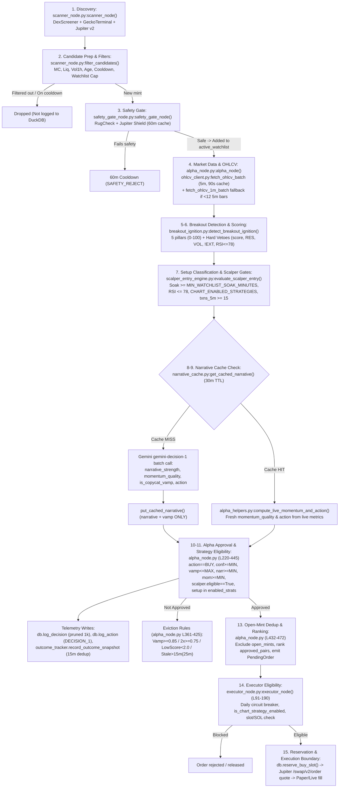

# DIRECTIVE 06 — PHASE A: Historical Decision Replay Simulator — Source & Data Feasibility Audit

**Project:** Solana Trading Agent (`solana-trading-agent`)  
**Workspace Branch:** `dev_1` (`eb776074ad498185e31b23574fc983e5edd24f0d`)  
**Strategy Scope:** `BREAKOUT_IGNITION` ONLY  
**Initial Feasibility Case:** PAIR (`32rBxcFjCFnyqZ41CEPM5AL67X1dcw8w83vZt6Kxpump`)  
**Phase:** A — Discovery, Source Mapping & Feasibility (READ-ONLY AUDIT — NO IMPLEMENTATION)  
**Audit Date:** `2026-11-26`  
**Database Snapshot Inspected (Read-Only `/tmp` Copy):** `reports/phase1/solana_meme_agent.duckdb` + `reports/phase1/solana_meme_agent.duckdb.wal`

---

## Evidence Classification Legend

Throughout this report, every claim is labeled with its exact verification status:

- **VERIFIED**: Directly confirmed by inspecting local source code, Git history, or read-only DuckDB queries.
- **PARTIALLY VERIFIED**: Supported by direct evidence for some fields/components, with explicit gaps in others.
- **INFERRED**: Deduced from runtime telemetry strings (e.g., `breakout_failed_gates`, exit reason strings) when the underlying `.env` or runtime binary is not directly readable.
- **UNKNOWN**: Cannot be determined from available local artifacts.
- **UNAVAILABLE**: External system or artifact (e.g., live Raspberry Pi filesystem, historical `journalctl` logs, historical OHLCV candles) is not accessible in this read-only audit environment.

---

## 1. Executive Summary

### Bottom-Line Feasibility Verdict

A **read-only, side-effect-free `BREAKOUT_IGNITION` Historical Decision Replay Simulator** is **FEASIBLE with explicit fidelity tiers**, provided it strictly enforces separation between **exact historical replay** and **diagnostic reconstruction**:

1. **Pure Decision Logic Is Safely Reusable (`VERIFIED`)**: The core `BREAKOUT_IGNITION` detector (`breakout_ignition.py:detect_breakout_ignition`), scalper entry gate (`scalper_entry_engine.py:evaluate_scalper_entry`), live momentum evaluator (`alpha_helpers.py:compute_live_momentum_and_action`), and chart exit engine (`chart_exit_engine.py:evaluate_chart_position_exit`) are **pure Python functions** with zero network I/O, zero DB writes, and zero import-time side effects.
2. **Strict Candle-Level Replay Is `NOT_REPLAYABLE` From DuckDB Alone (`VERIFIED`)**: Raw 5m and 1m OHLCV candles from GeckoTerminal and raw DexScreener `pair_data` (`txns.m5.buys/sells`, `txns.h1.buys/sells`, `volume`) are **never persisted** in DuckDB. Only derived scalar outputs (`breakout_score`, `breakout_state`, `breakout_timeframe`, `breakout_vol_ratio`, `breakout_ema_ext_pct`, `breakout_failed_gates`, `rsi`, `mc_usd`, `liq_usd`, `soak_minutes`, `narrative_score`, `momentum_score`, `vamp_score`, `buy_confidence`) are stored in `action_log` (100% populated across all 18,332 active-soak `DECISION_1` rows).
3. **Decision-Stage & Approval-Gate Replay IS Strictly Replayable (`VERIFIED`)**: For all 18,332 active-soak `DECISION_1` episodes (`2026-11-26T03:15:57Z` to `22:04:27Z`), `action_log` preserves every scalar score and failed-gate diagnostic required to verify why `alpha_node` issued `APPROVE`, `BLOCKED`, `WATCH`, `REJECT`, or `EVICT` — without calling Gemini, DexScreener, GeckoTerminal, or Jupiter.
4. **Historical Runtime Provenance Is `HISTORICAL_CODE_VERSION_UNVERIFIED` (`VERIFIED`)**: While local `dev_1` (`eb77607`, committed `2026-11-26T02:53:10Z`) predates PID `8315`'s start (`~2026-11-26T03:15:45Z`) by 22 minutes and matches telemetry behavior, direct read-only inspection of the Raspberry Pi filesystem and deployment checksums is `UNAVAILABLE`.
5. **PAIR (`32rBxc..pump`) Case Verdict (`VERIFIED`)**: At `2026-11-26T15:05:03.504192+00:00`, PAIR was **NOT** a silent miss or a single-gate near-miss. It was freshly discovered (`soak_minutes=0.05 < 1.0`), scored `breakout_score=18` (`FORMING`, failing `RES`, `VOL_SPIKE`, `COIL`, `BUY_RATIO`, `BUY_ACCEL`, `EMA`, `HTF_15M`), and was immediately rejected and evicted (`LOW_SCORE: narr=1.95, mom=1.26 < 2.0`). Its 4 reported metrics are verified as `mfe_pct=+95.42%`, `mae_pct=+0.00%`, `price_5m_pct=+24.09%`, and `price_15m_pct=+41.72%` (plus `price_1m_pct=+5.92%`, `price_30m_pct=+94.28%`). Strict candle-level replay of `detect_breakout_ignition()` for PAIR is `NOT_REPLAYABLE` (missing raw OHLCV); decision-stage audit and forward-outcome reconstruction are `VERIFIED` / `PARTIALLY_AVAILABLE`.

*Note: Per Directive 06, this report makes zero recommendations to alter trading thresholds or strategy behavior.*

---

## 2. Confirmed Facts Versus Assumptions

| Item | Status | Evidence / Basis |
| :--- | :--- | :--- |
| Toshiba workspace is on branch `dev_1` at commit `eb77607` with no tracked modifications | **VERIFIED** | `git status --short --branch` shows `## dev_1...origin/dev_1` and only untracked `reports/`. |
| GitHub default branch in this repo is `master` (`cfbd0bd`), not `main` | **VERIFIED** | `git show-ref` lists `refs/heads/master`, `refs/remotes/origin/master`, `refs/heads/dev_1`, `refs/remotes/origin/dev_1`. No `main` ref exists. |
| `dev_1` contains Directives 02, 03, and 04 (`a5f7ab4`, `f11797e`, `eb77607`) | **VERIFIED** | `git log --oneline` and `git diff --stat master..dev_1` (13 files, +838 / -38 lines). |
| Current Pi deployed files match Toshiba `dev_1` (`eb77607`) | **UNAVAILABLE** | No read-only SSH access, Pi file copy, or sync manifest exists in this workspace. |
| PID `8315` (`~2026-11-26T03:15:45Z`) ran exact `eb77607` code | **INFERRED / UNVERIFIED** | `eb77607` was committed 22m before soak start and telemetry matches Directive 02–04 log strings (`[LEG2_ENTRY_DISABLED -> COOLDOWN]`), but no cryptographic proof of Pi files exists (`HISTORICAL_CODE_VERSION_UNVERIFIED`). |
| Pi runtime `.env` overrode several `config.py` defaults during Phase 1 soak | **INFERRED** | `action_log.breakout_failed_gates` shows `VOL_SPIKE(...<0.7x)`, `COIL(...>7.0%)`, `breakout_score < 55`, `soak < 1m`, and `HARD_STOP_LOSS <= -12%` (vs `config.py` defaults `1.5x`, `10.0%`, `75`, `3.0m`, `10%`). Exact `.env` file is `UNAVAILABLE`. |
| Raw 5m/1m OHLCV candles are stored in DuckDB | **VERIFIED (FALSE)** | `PRAGMA table_info` across all 13 DuckDB tables confirms zero OHLCV candle tables or columns. |
| `decisions_log` is pruned to ~1,000 rows every 10 minutes | **VERIFIED** | `memory_guard.py:83,115-123` (`max_decisions_log=1000`); DB contains 1,018 rows spanning only `21:16:13Z`–`22:04:27Z` (~48 minutes). |
| `action_log` preserves full active-soak `DECISION_1` scalar features | **VERIFIED** | 19,230 active-soak rows (`03:15:57Z`–`22:04:27Z`), including 18,332 `DECISION_1` rows with 100% non-null `mc_usd`, `liq_usd`, `soak_minutes`, `rsi`, `narrative_score`, `momentum_score`, `vamp_score`, `buy_confidence`, and `breakout_*` fields. |
| `D1_failed_gates` contains soft scoring deductions in addition to hard vetoes | **VERIFIED** | `breakout_ignition.py:227-297,354-360`: `COIL`, `BUY_RATIO`, `BUY_ACCEL`, `EMA`, `VWAP`, `HTF` are score-only deductions, not hard vetoes. |
| PAIR `+95.42% / +0.00% / +24.09% / +41.72%` are `mfe_pct`, `mae_pct`, `price_5m_pct`, `price_15m_pct` | **VERIFIED** | Direct query of `candidate_outcomes` row `32rBxcFj-1795705503-0c8e52` (`2026-11-26T15:05:03.504192+00:00`) and `reports/phase1/phase1_soak_audit.md:202,211`. |

---

## 3. Source Provenance Comparison

| Source Location | Branch / Ref | Commit Hash | Working-Tree State | Comparison Status |
| :--- | :--- | :--- | :--- | :--- |
| **Toshiba Local Workspace** (`/home/tmalone1250/ToshibaDrive/Dev/Web3_Dev/solana-trading-agent`) | `dev_1` | `eb776074ad498185e31b23574fc983e5edd24f0d` | Clean for all tracked files; untracked `reports/` directory only | **VERIFIED** (Matches `origin/dev_1` byte-for-byte on tracked files) |
| **GitHub `origin/dev_1`** | `refs/remotes/origin/dev_1` | `eb776074ad498185e31b23574fc983e5edd24f0d` | N/A (remote-tracking ref) | **VERIFIED** (Identical commit to local `dev_1`) |
| **GitHub `origin/master`** *(note: no `main` branch exists)* | `refs/remotes/origin/master` | `cfbd0bd876626bba51541eac7786dc8b6c57e639` | N/A (remote-tracking ref) | **VERIFIED** (3 commits behind `dev_1`; lacks Directives 02–04) |
| **Raspberry Pi Deployment** (manual laptop sync) | `UNKNOWN` (no Git assumed) | `UNAVAILABLE` | `UNAVAILABLE` | **UNAVAILABLE** (No read-only SSH access or local Pi mirror) |

---

## 4. Git Branch and Commit Comparison

- **Current `dev_1` commit (`VERIFIED`)**: `eb776074ad498185e31b23574fc983e5edd24f0d` (`2026-11-25 20:53:10 -0600` / `2026-11-26T02:53:10Z`) — `Directive 4`.
- **Current `master` commit (`VERIFIED`)**: `cfbd0bd876626bba51541eac7786dc8b6c57e639` (`2026-11-25 18:33:19 -0600` / `2026-11-26T00:33:19Z`) — `Added Repo-Native DuckDB Soak Audit Report Exporter`. *(Note: Repository uses `master`, not `main`.)*
- **Commits unique to `dev_1` (`VERIFIED`)** — 3 commits, all containing Phase 1 `BREAKOUT_IGNITION` isolation changes:
  1. `a5f7ab4` (`2026-11-26T02:40:39Z`) — `BREAKOUT_IGNITION Isolation` (Directive 02)
  2. `f11797e` (`2026-11-26T02:48:56Z`) — `Directive 3` (Whale webhook vs strategy separation + early watcher abandonment)
  3. `eb77607` (`2026-11-26T02:53:10Z`) — `Directive 4` (Disabled watcher cleanup during coexisting open-position exits)
- **Commits unique to `master` (`VERIFIED`)**: `0` (fast-forward ancestor of `dev_1`).
- **Relevant file differences (`master..dev_1`, `VERIFIED`)**: 13 files changed (`+838 / -38` lines):
  - Runtime modules: `config.py` (+33), `scalper_entry_engine.py` (+18/-), `alpha_helpers.py` (+11/-), `alpha_node.py` (+15/-), `executor_node.py` (+10), `scanner_node.py` (+14/-), `chart_exit_engine.py` (+9/-), `position_monitor_node.py` (+43/-), `telemetry_api.py` (+4).
  - Config/Docs/Tests: `.env.example` (+5), `plan.md` (+19/-), `tests/test_breakout_isolation.py` (+410), `tests/test_whale_control_separation.py` (+285).
- **Changes during the soak period (`2026-11-26T03:15:45Z`–`22:04:27Z`, `VERIFIED` in Git)**: **Zero** commits occurred after `2026-11-26T02:53:10Z` in local Git history, and no tracked files have uncommitted edits.

---

## 5. Pi / Toshiba Source Comparison

| Check | Result | Status |
| :--- | :--- | :--- |
| Current Pi files match Toshiba workspace (`dev_1`) | Cannot verify without read-only Pi access | **UNAVAILABLE** |
| Current Pi files match `origin/dev_1` | Cannot verify without read-only Pi access | **UNAVAILABLE** |
| Differing files between Pi and Toshiba | Unknown | **UNAVAILABLE** |
| Pi file timestamps / deployment sync logs / backups | No local sync scripts, rsync logs, or Pi backups exist in `scripts/` or workspace root | **UNAVAILABLE** |

*Operational restriction honored: No SSH mutation, Git initialization, clone, pull, or deployment alteration was attempted on the Raspberry Pi.*

---

## 6. Relevant Source-File SHA-256 Fingerprints

All hashes below were computed directly on the Toshiba workspace (`dev_1` @ `eb776074ad498185e31b23574fc983e5edd24f0d`). Secrets and `.env` files are excluded.

| Relative File Path | SHA-256 Hash (`Toshiba` & `dev_1`) | `dev_1` vs `master` | Toshiba vs `dev_1` | Toshiba vs Pi |
| :--- | :--- | :--- | :--- | :--- |
| `breakout_ignition.py` | `e08f6aec98fcb1e9f1a4a7ed69082a6d394733c87ff7a83b201d0213dd964f09` | Identical | **MATCH** (`VERIFIED`) | **UNAVAILABLE** |
| `scalper_entry_engine.py` | `7db59df0a785c5d89df7c3563a95d4857f339963e8eaabe83ab9b4b4bba2eb92` | Modified in `dev_1` | **MATCH** (`VERIFIED`) | **UNAVAILABLE** |
| `alpha_helpers.py` | `6fbfb2f64fcc1ac9e8562cc025a85d68db4607d67f450477f012aa63d5dd2067` | Modified in `dev_1` | **MATCH** (`VERIFIED`) | **UNAVAILABLE** |
| `alpha_node.py` | `baf3694c2dfc039c512008d6c4598dd90ac46049b083cc7ccc02cbcfcf235b09` | Modified in `dev_1` | **MATCH** (`VERIFIED`) | **UNAVAILABLE** |
| `executor_node.py` | `a25aef47024ffdf8b4e3bc79720b8d6165bf616ca8f6b9eb9a3ed4caaa124fdd` | Modified in `dev_1` | **MATCH** (`VERIFIED`) | **UNAVAILABLE** |
| `scanner_node.py` | `f98c139cb4b570eb23e60e11a96046479af2f7da9f3d421036c9435b0137c66e` | Modified in `dev_1` | **MATCH** (`VERIFIED`) | **UNAVAILABLE** |
| `safety_gate_node.py` | `27ce079fb7f2557270a5f2c3a179c618311c9cad1f250b063b227b6caa022e84` | Identical | **MATCH** (`VERIFIED`) | **UNAVAILABLE** |
| `chart_exit_engine.py` | `a48dd61d9402d5b5a6c138721d4d46f2cbf3517e8ffec50ff831d836cec015e6` | Modified in `dev_1` | **MATCH** (`VERIFIED`) | **UNAVAILABLE** |
| `position_monitor_node.py` | `48f1be3eb5142d1a47f80486526c939fefcef034aa4015671a35df4429cbb2b5` | Modified in `dev_1` | **MATCH** (`VERIFIED`) | **UNAVAILABLE** |
| `batched_price_monitor.py` | `af41541ab944153c7cf6acef0cca242d4d2b5e4871713eec50f6483b075f8d10` | Identical | **MATCH** (`VERIFIED`) | **UNAVAILABLE** |
| `config.py` | `4b61b849408c0e3f10cdea0359fb9386e99bacf295054b171cba4c885287ed0e` | Modified in `dev_1` | **MATCH** (`VERIFIED`) | **UNAVAILABLE** |
| `ohlcv_client.py` | `bb212b41bb95c2a1a2b574c1c839046e466d26a943390cb9cc6cf1ef24115d4b` | Identical | **MATCH** (`VERIFIED`) | **UNAVAILABLE** |
| `narrative_cache.py` | `367ef653882b055274897a046c79cbf985addec1c5762743d6cd8b64b6399a64` | Identical | **MATCH** (`VERIFIED`) | **UNAVAILABLE** |
| `decision_client.py` | `c176afedda977d6ec75b8d45bdb7fbe42b0b80279c9cb6543d214f7b424aa195` | Identical | **MATCH** (`VERIFIED`) | **UNAVAILABLE** |
| `jupiter_token_client.py` | `6ccf7dc6a073b448b2c024cc7178a7f61cbdb4f8d20cdccac403cc9793d8f33a` | Identical | **MATCH** (`VERIFIED`) | **UNAVAILABLE** |
| `leg2_predictor.py` | `e35f97fe2c4abcb93c39434e174eef1882654a7aa70c490fdb300750f55dc92d` | Identical | **MATCH** (`VERIFIED`) | **UNAVAILABLE** |
| `state.py` | `54a0ab3efd5563a55a2a42ea64603540b803b5fe1eeeb2de42b5a0abf1cda819` | Identical | **MATCH** (`VERIFIED`) | **UNAVAILABLE** |
| `state_ledger.py` | `31111d2a1f79ad16c9a4da3f9a3925c2a2d131009e85c1042aeb580e2676f11a` | Identical | **MATCH** (`VERIFIED`) | **UNAVAILABLE** |
| `db.py` | `d66bcc5135b19cbe464b07cf34b1c6f2c25c7881f928e5057b4a358eae0c26da` | Identical | **MATCH** (`VERIFIED`) | **UNAVAILABLE** |
| `outcome_tracker.py` | `af4e577eadbaca98614499b0ba6421f008370210367068e42306cc57de934f60` | Identical | **MATCH** (`VERIFIED`) | **UNAVAILABLE** |
| `memory_guard.py` | `309c20ad84a9aa24f65e2334cad90afac1739c05dc1477c28874d7043d655216` | Identical | **MATCH** (`VERIFIED`) | **UNAVAILABLE** |
| `graph.py` | `5746a1c26ef202400a6b0789fefe837ecebc00ad3961253c01271243fa770e68` | Identical | **MATCH** (`VERIFIED`) | **UNAVAILABLE** |
| `main.py` | `82551b1a110efefabae1b3dc85145291d2c0686b9e45bd4e3ca7c25bc167e7eb` | Identical | **MATCH** (`VERIFIED`) | **UNAVAILABLE** |

---

## 7. Historical Runtime Provenance Assessment

**Verdict: `HISTORICAL_CODE_VERSION_UNVERIFIED`**

- **Corroborating circumstantial evidence (`PARTIALLY VERIFIED` / `INFERRED`)**:
  - Commit `eb77607` (`Directive 4`) was authored on Toshiba at `2026-11-26T02:53:10Z`, **22 minutes before** PID `8315` started at `~2026-11-26T03:15:45Z`.
  - Phase 1 DuckDB telemetry exhibits exact string signatures introduced in Directives 02–04: e.g., trade #360 (`PUMPCHAN`, `07:14:28Z`) logs `TRAILING_TP (...) [LEG2_ENTRY_DISABLED -> COOLDOWN]`, and `0` non-`BREAKOUT_IGNITION` entries were opened across all 17 active-soak BUYs.
- **Why exact provenance cannot be certified (`VERIFIED` gap)**:
  - No Git commit SHA or file hash is persisted into DuckDB (`agent_state`, `action_log`, or `trades`) at startup.
  - No deployment receipt, sync timestamp log, or Pi filesystem snapshot exists in the repository.
  - Runtime `.env` values on the Pi are not persisted in DuckDB; several effective thresholds (`BREAKOUT_MIN_VOL_RATIO=0.7`, `BREAKOUT_MAX_COIL_RANGE_PCT=7.0`, `BREAKOUT_MIN_SCORE=55`, `MIN_WATCHLIST_SOAK_MINUTES=1.0`, `HARD_STOP_LOSS_PCT=0.12`) are `INFERRED` solely from telemetry strings.

Therefore, any future replay engine **must** stamp outputs with `runtime_provenance = "HISTORICAL_CODE_VERSION_UNVERIFIED"` and require an explicit config profile (e.g., `inferred_phase1_pi_profile` vs `repo_defaults`) rather than silently assuming `config.py` defaults matched PID `8315`.

---

## 8. Actual `BREAKOUT_IGNITION` Pipeline Diagram

Traced directly from `graph.py`, `scanner_node.py`, `safety_gate_node.py`, `alpha_node.py`, `ohlcv_client.py`, `scalper_entry_engine.py`, `breakout_ignition.py`, `alpha_helpers.py`, `narrative_cache.py`, and `executor_node.py` (`VERIFIED`):



---

## 9. Function-Level Dependency Map

| Stage | File & Function | Inputs | Outputs | Can Reject? | Hard Veto vs Score Deduction | Skippable? | External Deps | Historical Input Recovery |
| :--- | :--- | :--- | :--- | :--- | :--- | :--- | :--- | :--- |
| **1. Discovery** | `scanner_node.py:scanner_node` (`L376`), `fetch_dexscreener_trending_solana` (`L223`), `fetch_geckoterminal_trending_solana` (`L77`), `jupiter_token_client.py:fetch_discovery_mints` | `AgentConfig`, `httpx.AsyncClient` | Raw mint/pair list | Yes (omission) | Hard (not discovered) | No | DexScreener, GeckoTerminal, Jupiter v2 | `MISSING` (no discovery log) |
| **2. Candidate Prep** | `scanner_node.py:_parse_pair_to_candidate` (`L119`), `filter_candidates` (`L188`) | Pair JSON, `AgentConfig`, `db.is_on_cooldown` | Filtered `CandidateToken` list | Yes | Hard veto (MC, liq, vol1h, age, cooldown) | No | DuckDB (`cooldowns`) | `PARTIALLY_AVAILABLE` (watchlist survivors only) |
| **3. Safety Gate** | `safety_gate_node.py:safety_gate_node` (`L265`), `evaluate_rugcheck_summary` (`L77`), `evaluate_jupiter_shield` (`L158`) | Mint, RugCheck JSON, Jupiter Shield JSON | `SafetyReport` (safe/unsafe) | Yes | Hard veto (60m cooldown) | Cached 60m | RugCheck, Jupiter Shield | `MISSING` (only cooldown reason if failed) |
| **4. OHLCV Fetch** | `ohlcv_client.py:fetch_ohlcv_batch`, `fetch_ohlcv_1m_batch`, `should_fetch_1m_fallback` (`L118`) | `pair_address`, `AgentConfig` | `candles_5m`, `candles_1m` | Indirect (`BARS<12/15`) | Leads to `detected=False` | 90s cache / 429 backoff | GeckoTerminal OHLCV API | `MISSING` (candles never persisted) |
| **5–6. Breakout Detection & Scoring** | `breakout_ignition.py:detect_breakout_ignition` (`L124`), `compute_ema_series` (`L42`), `compute_vwap` (`L53`), `_aggregate_to_15m` (`L69`), `_is_htf_15m_bullish` (`L94`), `_extract_flow_and_accel` (`L107`) | `candles`, `pair_data`, `rsi_val`, `config` | `BreakoutIgnitionResult` (`detected`, `score`, `state`, `failed_gates`) | Yes | **Both** (5 hard vetoes + 6 score-only items; see §10) | No | **None (Pure)** | Outputs `EXACT_HISTORICAL`; raw inputs `MISSING` |
| **7. Setup Classification** | `scalper_entry_engine.py:evaluate_scalper_entry` (`L185`), `compute_rsi` (`L55`) | `candles_5m`, `candles_1m`, `pair_data`, `soak_minutes`, `config` | `ScalperEntryResult` (`eligible`, `setup_type`, `rsi_5m`) | Yes | Hard veto (soak, RSI, enabled strategy, txns_5m) | No | **None (Pure)** | `PARTIALLY_AVAILABLE` (`soak`, `rsi` logged; `txns_5m` missing) |
| **8–9. Narrative & Momentum** | `narrative_cache.py:get_cached_narrative` (`L40`), `decision_client.py:GeminiDecisionClient.decide` (`L70`), `alpha_helpers.py:compute_live_momentum_and_action` (`L63`) | Candidate metrics, `ScalperEntryResult`, cached narrative | `narrative_strength`, `momentum_quality`, `is_copycat_vamp`, `action`, `action_confidence` | Yes (`WATCH`/`REJECT`) | Soft scores evaluated at Stage 10 | Gemini skipped on 30m cache hit | Gemini API on cache miss; **None (Pure)** on cache hit | Scores `EXACT_HISTORICAL` in `action_log`; `cache_hit` only in `decisions_log` (pruned) |
| **10–11. Alpha Approval** | `alpha_node.py:alpha_node` (`L220-445`) | `AlphaDecision`, `ScalperEntryResult`, `config` | `approved` bool, `DECISION_1` log, `EVICT` | Yes | Hard veto (all thresholds ANDed) | No | DuckDB writes + OutcomeTracker | `EXACT_HISTORICAL` in `action_log` |
| **12–13. Cooldown, Open-Mint & Ranking** | `alpha_node.py:alpha_node` (`L432-472`) | `approved_pairs`, `db.get_all_open_mints()` | Winner `PendingOrder` | Yes (already open / outranked) | Hard veto / ranking | No | DuckDB read | `PARTIALLY_AVAILABLE` (reconstructable from `trades`) |
| **14–15. Executor Boundary** | `executor_node.py:executor_node` (`L91-190`), `fetch_jupiter_order` (`L47`), `state_ledger.py:reserve_buy_slot` | `PendingOrder`, `AgentConfig`, `db` | Trade fill / rejection | Yes | Hard veto (circuit breaker, strategy allowlist, slots, SOL, quote) | No | Jupiter `/swap/v2/order`, DuckDB ledger | `OBSERVED_QUOTE` for executed trades; `UNAVAILABLE` for non-executed |

---

## 10. Gate and Threshold Inventory

### A. `breakout_ignition.py:detect_breakout_ignition` (`L124-365`) — Hard Vetoes vs Score Deductions

**Critical Distinction (`VERIFIED`)**: `D1_failed_gates` (`action_log.breakout_failed_gates`) concatenates **all** failed items from lines `227-297`, mixing hard vetoes with score-only deductions. Final `detected` (`L354-360`) requires **ONLY** the 5 hard vetoes:

```python
detected = (
    final_score >= score_thresh
    and res_passed
    and vol_passed
    and state != "EXTENDED"
    and rsi_ok
)
```

| Gate / Diagnostic Tag | Code Location | Points | Type | Repo Default (`config.py`) | Phase 1 Pi Effective (`INFERRED` from `action_log`) | Can Appear in `D1_failed_gates` on an Approved `BUY`? |
| :--- | :--- | :---: | :--- | :--- | :--- | :---: |
| `BARS(n<min)` | `L140-155` | — | **Hard Veto** | `12` (5m) / `15` (1m) | `12` (5m) / `15` (1m) | No |
| `final_score >= score_thresh` | `L168-172, 355` | 0–100 | **Hard Veto** | `75` (`BREAKOUT_MIN_SCORE`) | `55` (`INFERRED`) | No |
| `RES` (`res_passed`: close > swing high, green candle, `body_pos >= 65%`) | `L188-195, 235-242, 356` | 25 (12 partial) | **Hard Veto** | `swing_lookback=6` (5m), `body>=0.65` | Same (`VERIFIED` in code) | No |
| `VOL` (`VOL_SPIKE`: `vol_ratio >= vol_thresh`) | `L157-161, 200-201, 244-250, 357` | 10 (5 partial) | **Hard Veto** | `1.5x` (`BREAKOUT_MIN_VOL_RATIO`) | `0.7x` (`INFERRED` from `VOL_SPIKE(0.5x<0.7x)`) | No |
| `EXT` (`state != "EXTENDED"`: `ext_ema9 <= 12%` AND `ext_vwap <= 12%`) | `L218-220, 292-301, 358` | 8 | **Hard Veto** | `+12%` (`max_extension_pct=0.12`) | `+12%` (`VERIFIED` in `EXT(...>+12%)`) | No |
| `RSI` (`rsi_ok`: `rsi_val <= 78.0`) | `L213, 280-284, 359` | 5 | **Hard Veto** | `78.0` | `78.0` (`VERIFIED` in `RSI(78.1>78)`) | No |
| `COIL` (`coil_range_pct <= coil_max` OR 3 higher lows) | `L179-185, 227-233` | 20 (10 partial) | **Score Deduction Only** | `10.0%` (`BREAKOUT_MAX_COIL_RANGE_PCT`) | `7.0%` (`INFERRED` from `COIL(...>7.0%)`) | **YES** |
| `FLOW` (`BUY_RATIO`: `buy_ratio_5m >= 62%`) | `L252-258` | 8 (4 partial) | **Score Deduction Only** | `62%` (55% partial) | `62%` (`VERIFIED` in `BUY_RATIO(...<62%)`) | **YES** |
| `ACCEL` (`BUY_ACCEL`: `buys_accel >= 1.5x`) | `L260-266` | 7 (3 partial) | **Score Deduction Only** | `1.5x` (1.2x partial) | `1.5x` (`VERIFIED` in `BUY_ACCEL(...<1.5x)`) | **YES** |
| `EMA` (`ema9 > ema21` & rising) | `L205-210, 268-272` | 5 | **Score Deduction Only** | Hardcoded | Hardcoded | **YES** |
| `VWAP` (`price > vwap`) | `L211-212, 274-278` | 5 | **Score Deduction Only** | Hardcoded | Hardcoded | **YES** |
| `HTF` (`HTF_15M`: 15m bullish) | `L216-217, 286-290` | 7 | **Score Deduction Only** | Hardcoded | Hardcoded | **YES** |

### B. Downstream Entry & Approval Gates (`scalper_entry_engine.py`, `alpha_node.py`, `executor_node.py`)

| Gate | Location | Repo Default | Phase 1 Pi (`INFERRED`) | Effect |
| :--- | :--- | :--- | :--- | :--- |
| Watchlist Soak Time | `scalper_entry_engine.py:210` | `3.0m` (`MIN_WATCHLIST_SOAK_MINUTES`) | `1.0m` (`soak 0.0m < 1m`) | Hard veto (`eligible=False`) |
| Strategy Allowlist | `scalper_entry_engine.py:225`, `alpha_node.py:439`, `executor_node.py:129` | All 4 Chart strategies | `BREAKOUT_IGNITION` only | Hard veto |
| 5m Transaction Count | `scalper_entry_engine.py:296` | `15` (`SCALPER_MIN_TXNS_5M`) | `UNKNOWN` (not logged) | Hard veto (`eligible=False`) |
| 5m Buy Ratio (Scalper) | `scalper_entry_engine.py:303` | `58%` — **EXEMPT** for `BREAKOUT_IGNITION` | Exempt (`VERIFIED` in code) | Skipped for `BREAKOUT_IGNITION` |
| Alpha Action & Thresholds | `alpha_node.py:220-230, 301-308` | `action=='BUY'`, `conf>=0.60`, `vamp<=0.55`, `narr>=2.5`, `mom>=3.0` | `UNKNOWN` (exact `.env` unavailable; `LOW_SCORE` eviction confirmed `< 2.0`) | Hard veto (`BLOCKED` / `WATCH` / `REJECT`) |
| Eviction: Low Score | `alpha_node.py:391-406` | `narr < 2.0 AND mom < 2.0` (2 strikes if coiling) | `2.0` (`VERIFIED` in `LOW_SCORE (narr=1.95, mom=1.26 < 2.0)`) | Removes from watchlist + 15m cooldown |
| Eviction: Vamp / Stale | `alpha_node.py:363-380, 411-424` | `vamp>=0.85`, 2x `>=0.75`, stale `>15m` (`25m` coiling) | `UNKNOWN` | Removes from watchlist + cooldown |
| Executor Risk & Slots | `executor_node.py:110-185` | `MAX_CHART_POSITIONS=3`, `TRADE_SIZE_SOL=0.5`, `DAILY_MAX_LOSS_PCT=0.20` | `TRADE_SIZE_SOL=0.5` (`VERIFIED` in `trades`) | Hard veto |

---

## 11. Database Schema and Timestamp Inventory

Inspected via read-only `/tmp` copy of `reports/phase1/solana_meme_agent.duckdb` (18.89 MB) + `solana_meme_agent.duckdb.wal` (7.77 MB) (`VERIFIED`).

| Table | Total Rows | Timestamp Column(s) | Earliest Timestamp (UTC) | Latest Timestamp (UTC) | Retention / Pruning | Mint Linkability |
| :--- | ---: | :--- | :--- | :--- | :--- | :--- |
| `action_log` | 20,022 *(19,230 active soak)* | `timestamp_utc` (`VARCHAR`) | `2026-11-26T02:32:16.281607+00:00` | `2026-11-26T22:04:27.495233+00:00` | Pruned to `20,000` rows every 10m (`memory_guard.py:118`) | High (`asset_id` + `timestamp_utc`) |
| `decisions_log` | 1,018 | `timestamp` (`VARCHAR`) | `2026-11-26T21:16:13.862606+00:00` | `2026-11-26T22:04:27.507319+00:00` | **Aggressively pruned** to `1,000` rows (~48m window) | High within last ~48m; **LOST** for earlier episodes |
| `candidate_outcomes` | 4,027 | `discovered_at` (`VARCHAR`) | `2026-11-22T19:03:15.032461+00:00` | `2026-11-26T22:02:33.649653+00:00` | **Never pruned** | Exact timestamp join to `action_log` (`DECISION_1`), but **15m per-mint dedup** drops intermediate rows |
| `trades` | 388 *(34 active soak: 17 BUY, 17 SELL)* | `timestamp`, `opened_at` (`VARCHAR`) | `2026-11-20T02:06:04.484551+00:00` | `2026-11-26T21:44:43.409113+00:00` | **Never pruned** | Exact (`mint`, `timestamp`, `opened_at`) |
| `active_watchlist` | 1 | `added_at`, `last_evaluated_at` (`VARCHAR`) | `2026-11-26T21:56:25.805793+00:00` | `2026-11-26T22:04:27.495233+00:00` | Ephemeral (live snapshot only; evicted rows deleted) | Current snapshot only |
| `cooldowns` | 17 | `expires_at` (`VARCHAR`) | `2026-11-26T22:02:10.739945+00:00` | `2026-11-26T22:44:43.361136+00:00` | Ephemeral; future expiration time, not event time | Snapshot only |
| `agent_state` | 1 | `updated_at` (`VARCHAR`) | `2026-11-26T21:44:43.395098+00:00` | `2026-11-26T21:44:43.395098+00:00` | Single-row mutable state | Updated only on position/state writes (20m behind `action_log`) |
| `whale_events` / `whale_signals` / `whale_decisions` / `social_signals` / `x_seen_tweets` / `x_worker_state` | 361 / 87 / 72 / 0 / 585 / 1 | `timestamp_utc` / `updated_at` / `fetched_at_utc` | Pre-soak (`<= 03:05:16Z`) | Pre-soak | Not dependencies of isolated `BREAKOUT_IGNITION` (`ENABLE_HELIUS_WHALE_WEBHOOK=False`, `ENABLE_X_DISCOVERY=False`) | Out of scope |

**Active-Soak `action_log` Non-Null Coverage (`VERIFIED`)**: Across all `18,332` active-soak `DECISION_1` rows (`>= 2026-11-26T03:15:45Z`), **100.0%** (`18,332 / 18,332`) have non-null `mc_usd > 0`, `liq_usd > 0`, `soak_minutes`, `rsi`, `narrative_score`, `momentum_score`, `vamp_score`, `buy_confidence`, `breakout_score`, `breakout_state`, `breakout_timeframe`, `breakout_vol_ratio`, `breakout_ema_ext_pct`, and `breakout_failed_gates`. Note: `price_or_value` is `NULL` on `DECISION_1` rows (only populated on `BUY`/`SELL`).

---

## 12. Telemetry Retention and Deduplication Findings

All 6 known telemetry limitations from Phase 1 were **VERIFIED** directly against source code and DuckDB:

1. **`decisions_log` 1,000-Row Hard Cap (`VERIFIED`)**: `memory_guard.py:83,115-123` (`prune_duckdb_tables`) runs every 10 minutes via `main.py:61` and deletes all but the newest `1,000` rows. Consequently, `decisions_log` only covers `21:16:13Z`–`22:04:27Z` (~48 minutes). Full `scores_json` (which is the **only** place `breakout_metrics`, `ema9`, `ema21`, `vwap`, `coil_range_pct`, `body_pos_pct`, `narrative_cache_hit`, and `narrative_cached_at` are persisted) is permanently lost for all episodes prior to `21:16:13Z` — including PAIR (`13:42Z`–`19:51Z`) and 16 of 17 active-soak trades.
2. **`candidate_outcomes` 15-Minute Per-Mint Deduplication (`VERIFIED`)**: `outcome_tracker.py:21,168-170,222` (`DEDUP_WINDOW_SECONDS = 900.0`) silently drops any call to `record_outcome_snapshot()` for a mint recorded within the prior 15 minutes.
3. **Repeated Observations Dominate Candidate Counts (`VERIFIED`)**: Because `DEDUP_WINDOW_SECONDS` resets every 15 minutes while a token remains on or re-enters the watchlist, a single mint like PAIR generates **20 rows** in `candidate_outcomes` and **382 rows** (`362 DECISION_1` + `20 EVICT`) in `action_log`. Replay analytics must group by `(mint, decision_episode)` rather than treating rows as independent opportunities.
4. **`ENTERED` Snapshots Suppressed After Prior `WATCH`/`REJECTED` (`VERIFIED`)**: Because `alpha_node.py:324` calls `record_outcome_snapshot()` on every `DECISION_1` cycle, a token watched at `T` and entered at `T + 3m` is silently dropped by the 15-minute dedup gate. Absence of an `ENTERED` row in `candidate_outcomes` is **never** proof that a trade did not occur; `trades` is the authoritative execution ledger.
5. **`agent_state.updated_at` Lags Live Pipeline Activity (`VERIFIED`)**: `agent_state.updated_at` is `2026-11-26T21:44:43.395098+00:00` (last trade close), whereas `action_log` continues through `22:04:27.495233+00:00` (19m 44s later).
6. **`cooldowns.expires_at` Is a Future Expiration Timestamp (`VERIFIED`)**: `cooldowns.expires_at` stores `now + cooldown_duration` (up to `22:44:43Z`, 40m after DB capture). Event start time can only be approximated by subtracting the rule-specific cooldown duration if the `reason` string identifies the rule.

---

## 13. Historical Input Availability Matrix

| Decision Input | Availability Class | Primary Historical Source | Timestamp / Coverage Limitations |
| :--- | :--- | :--- | :--- |
| Market Cap (`mc_usd`) & Liquidity (`liq_usd`) | **`EXACT_HISTORICAL`** | `action_log` (`DECISION_1`, 100% coverage) | Exact at `DECISION_1` tick; not recorded on `EVICT` rows. |
| Token USD Price (`price_usd`) | **`PARTIALLY_AVAILABLE`** | `candidate_outcomes.entry_price_usd` (every >=15m) | `NULL` in `action_log.price_or_value` for `DECISION_1` rows; can be ratio-approximated from `mc_usd` between snapshots (`RECONSTRUCTABLE`). |
| 1m & 5m Raw OHLCV Candles | **`MISSING`** | Not persisted anywhere in DuckDB | Would require external historical OHLCV backfill (`DIAGNOSTIC_RECONSTRUCTION` only; never `STRICT_REPLAY`). |
| Volume (`vol_1h`, `vol_5m`) & Txn Counts (`txns_5m`) | **`MISSING`** | Not persisted in `action_log` | `SCALPER_MIN_TXNS_5M` gate cannot be strictly re-evaluated. |
| Breakout Derived Outputs (`score`, `state`, `timeframe`, `vol_ratio`, `ema_ext_pct`, `failed_gates`) | **`EXACT_HISTORICAL`** | `action_log` (`DECISION_1`, 100% coverage) | Exact detector outputs; sufficient to audit downstream gates, not to re-run `detect_breakout_ignition()` from candles. |
| Detailed `breakout_metrics` (`ema9`, `ema21`, `vwap`, `coil_range_pct`, `body_pos_pct`, `htf_bullish`) | **`PARTIALLY_AVAILABLE`** | `decisions_log.scores_json` (last ~48m only) | Pruned prior to `21:16:13Z`. Partial values recoverable via regex from `breakout_failed_gates` (e.g., `COIL(91.6%>7.0%)`, `BUY_RATIO(53%<62%)`, `BUY_ACCEL(0.6x<1.5x)`). |
| RSI (`rsi_5m` / `rsi`) | **`EXACT_HISTORICAL`** | `action_log.rsi` (100% coverage) | Exact value computed from cached OHLCV at `DECISION_1`. |
| Watchlist Soak Time (`soak_minutes`) | **`EXACT_HISTORICAL`** | `action_log.soak_minutes` (100% coverage) | Exact elapsed minutes since `added_at`. |
| Narrative Score, Vamp Score, Momentum Score, Buy Confidence | **`EXACT_HISTORICAL`** | `action_log` (`narrative_score`, `vamp_score`, `momentum_score`, `buy_confidence`) | Rounded to 2–3 decimals in `action_log`. |
| Narrative Cache Hit & `narrative_cached_at` | **`PARTIALLY_AVAILABLE`** | `decisions_log.scores_json` (last ~48m only) | For older rows, cache hit is `INFERRED` when `narrative_score` & `vamp_score` remain identical across consecutive ticks within 30m. |
| 5m Buy/Sell Ratio & Buy Acceleration | **`PARTIALLY_AVAILABLE`** | Embedded in `action_log.breakout_failed_gates` | Only logged when `< 62%` (`BUY_RATIO(...)`) or `< 1.5x` (`BUY_ACCEL(...)`); exact value `MISSING` when gate passed! |
| Safety Gate Report (RugCheck / Jupiter Shield) | **`MISSING`** | Ephemeral 60m in-memory cache | Reaching `DECISION_1` implies safety passed within prior 60m (`INFERRED`). |
| Cooldown State at Decision Time | **`PARTIALLY_AVAILABLE`** | Reconstructable from prior `EVICT` / `SELL` rows in `action_log`/`trades` | Exact `SAFETY_REJECT` cooldowns are `MISSING` once expired. |
| Open Position & Slot State at Decision Time | **`RECONSTRUCTABLE`** | `trades` (`opened_at` to `SELL.timestamp`) | Exact for all active-soak Chart positions. |
| Feature Flags & Historical `.env` Config | **`PARTIALLY_AVAILABLE`** / **`UNKNOWN`** | `config.py` defaults + telemetry-inferred overrides | Exact Pi `.env` file is `UNAVAILABLE`; key overrides are `INFERRED` from failed-gate strings. |

---

## 14. Timestamp and Look-Ahead Bias Assessment

### Timestamp Lineage & Leakage Risks (`VERIFIED`)

| Event | Stored Timestamp | Look-Ahead / Staleness Risk |
| :--- | :--- | :--- |
| Candidate Discovery (`added_at`) | Only in `active_watchlist` (deleted on eviction); reconstructable as `DECISION_1.timestamp_utc - soak_minutes` | Low risk; deterministic subtraction. |
| OHLCV Candle Fetch & Cache Age | **Not persisted** (`ohlcv_client.py` 90s cache + 6.5s pacing) | **Staleness risk**: `DECISION_1` ticks every ~17s reuse the same cached 5m candles for up to 90s (confirmed in PAIR `15:22:03Z`–`15:24:55Z`, where `rsi=69.46` and `vol_ratio=0.54` stayed frozen across 11 ticks while `mc_usd` moved). |
| Candle Formation vs Completion | `breakout_ignition.py:174` uses `curr = candles[-1]` (the live, currently forming 5m/1m bar from GeckoTerminal) | **CRITICAL Look-Ahead Bias Risk**: Reconstructing historical OHLCV from finalized post-hoc 5m candles injects future intra-bar high/low/close/volume that did NOT exist at `DECISION_1.timestamp_utc`! |
| Narrative Generation vs Cache Retrieval | `narrative_cached_at` only in `decisions_log` (pruned >48m) | Using a later Gemini call or re-calling Gemini today introduces severe look-ahead/model-drift bias. |
| `candidate_outcomes` Forward Horizons | `outcome_tracker.py:287-294` polls DexScreener every 60s and stamps `price_1m_pct` (`>=60s`), `price_5m_pct` (`>=300s`), `price_15m_pct` (`>=900s`), `price_30m_pct` (`>=1800s`), plus running `mfe_pct`/`mae_pct` | **Zero leakage into decision** as long as replay strictly blocks access to `price_*_pct`, `mfe_pct`, `mae_pct`, and `finalized` during decision evaluation. Note: 60s polling jitter means `price_1m_pct` may be sampled anywhere between `60s` and `119s`, and intra-minute spikes/dips between polls are unseen. |
| Clock Discrepancies | All DuckDB timestamps are UTC ISO-8601 from the Pi's system clock (`utc_now()`). | Single-host monotonic consistency (`VERIFIED`); no cross-host clock skew within DuckDB. |

### Feasibility of the Three Proposed Replay Modes

1. **`STRICT_REPLAY` — `PARTIALLY FEASIBLE` (Decision-Stage Only; Candle-Stage `NOT_REPLAYABLE`)**
   - **Feasible**: Replaying `alpha_node` approval/rejection/eviction gates (`L220-445`) and `executor_node` strategy/slot eligibility using `EXACT_HISTORICAL` scalar columns from `action_log` + reconstructed open positions from `trades`.
   - **Not Feasible**: Re-running `detect_breakout_ignition(candles, pair_data)` strictly, because raw live-forming OHLCV bars and raw `pair_data` were never persisted.
2. **`DIAGNOSTIC_RECONSTRUCTION` — `FEASIBLE` (With Mandatory Provenance Tagging)**
   - Can combine `action_log` scalar timelines (`~17s` cadence) with `candidate_outcomes` forward horizons (`1m/5m/15m/30m/MFE/MAE`) and optional offline-fetched historical OHLCV (strictly tagged `source="RECONSTRUCTED_OHLCV"`, `lookahead_warning="COMPLETED_CANDLE_NOT_LIVE_BAR"`).
3. **`COUNTERFACTUAL_EXPERIMENTATION` — `FEASIBLE` (Future Phase, Downstream Gates First)**
   - Can safely run one-variable-at-a-time counterfactuals on logged scalar gates (`MIN_WATCHLIST_SOAK_MINUTES`, `BREAKOUT_MIN_SCORE`, `MIN_NARRATIVE_SCORE`, `MIN_MOMENTUM_SCORE`, `MAX_VAMP_ENTRY`, `MIN_BUY_CONFIDENCE`, `LOW_SCORE_EVICT_THRESHOLD`) without modifying live config or claiming hypothetical PnL as historical fills.

---

## 15. Safe Code Reuse Assessment

| Component | Module & Function | Safe to Reuse Directly? | External / State Dependencies | Recommended Isolation Pattern |
| :--- | :--- | :--- | :--- | :--- |
| Breakout Detection & Scoring | `breakout_ignition.py:detect_breakout_ignition` | **YES (`VERIFIED`)** | None (pure function; takes `candles`, `pair_data`, `config`) | Direct import + synthetic `AgentConfig` |
| Indicator Calculations (EMA, VWAP, RSI) | `breakout_ignition.py:compute_ema_series`, `compute_vwap`; `scalper_entry_engine.py:compute_rsi`, `compute_ema` | **YES (`VERIFIED`)** | None (pure functions) | Direct import |
| Scalper Entry Gate | `scalper_entry_engine.py:evaluate_scalper_entry` | **YES (`VERIFIED`)** | `AgentConfig` only (pure function) | Direct import + explicit `AgentConfig(_env_file=None, ...)` |
| Live Momentum & Action (Cache-Hit Path) | `alpha_helpers.py:compute_live_momentum_and_action` | **YES (`VERIFIED`)** | `AgentConfig`, `ScalperEntryResult`, `Leg2Result` (pure function) | Direct import (note: `alpha_helpers.py` imports `db` & `decision_client` at module level, see §16) |
| Chart Exit Engine | `chart_exit_engine.py:evaluate_chart_position_exit`, `compute_exodus` | **YES (`VERIFIED`)** | `AgentConfig`, `ActivePosition` (pure function) | Direct import |
| Full `alpha_node()` | `alpha_node.py:alpha_node` | **NO (without mocks)** | Calls GeckoTerminal OHLCV, Gemini API, `db.log_decision`, `db.log_action`, `db.update_watchlist_scores`, `record_outcome_snapshot`, global `_narrative_cache` | Do **not** call directly in replay; either extract/invoke pure sub-functions or inject no-op/in-memory stubs |
| Full `executor_node()` | `executor_node.py:executor_node` | **NO (PROHIBITED)** | Calls Jupiter `/swap/v2/order`, `solders.Keypair`, signs live txns if `EXECUTION_MODE='live'`, mutates DuckDB ledger | **Never invoke in simulator.** Reuse only `config.is_chart_strategy_enabled()` |

---

## 16. Import Side-Effect Assessment

Performed via static AST inspection of all 23 relevant modules (`VERIFIED`, zero code executed):

| Module | Top-Level Side Effects | External / Stateful Imports | Safety Verdict |
| :--- | :--- | :--- | :--- |
| `breakout_ignition.py` | None | `pydantic` only | **100% Safe** |
| `leg2_predictor.py` | None | `pydantic` only | **100% Safe** |
| `state.py` | None | `pydantic` only | **100% Safe** |
| `config.py` | `VALID_CHART_STRATEGIES = frozenset(...)` only. **CRITICAL NOTE**: Instantiating `AgentConfig()` reads local `.env` via `SettingsConfigDict(env_file=".env")`! | `pydantic_settings` | **Safe at import**; simulator MUST instantiate `AgentConfig(_env_file=None, ...)` so local `.env` secrets/flags never leak into replay! |
| `scalper_entry_engine.py` | None | `breakout_ignition`, `config` | **100% Safe** |
| `narrative_cache.py` | Module-level dict `_narrative_cache = {}` | stdlib only | **Safe** (in-memory only; call `clear_narrative_cache()` between runs) |
| `ohlcv_client.py` | Module-level caches `_ohlcv_cache`, `_breakout_telemetry_cache`, `_loop_locks` | `httpx`, `config`, `memory_guard` | **Safe at import** (no network calls at import time) |
| `decision_client.py` | None (`genai.Client` is lazily created inside `_get_client()`) | `google.genai` | **Safe at import** (never instantiate or call `.decide()`) |
| `alpha_helpers.py` | None | Imports `db`, `decision_client`, `leg2_predictor`, `scalper_entry_engine`, `state` | **Safe at import** (none of those open DB/network at import) |
| `db.py` | None (`duckdb.connect` only runs inside `AgentDatabase.__init__`) | `duckdb`, `state_ledger`, `outcome_tracker`, `memory_guard` | **Safe at import**; simulator must NEVER instantiate `AgentDatabase` on the live DB — use read-only `/tmp` snapshot connection only |
| `chart_exit_engine.py` | None | `batched_price_monitor` -> `executor_node` -> `solders` | **Safe at import** (no I/O at import), but pulls in `executor_node` transitively |
| `main.py` | **Calls `logging.basicConfig(...)` at `L22`** | Imports entire app (`uvicorn`, `telemetry_api`, `whale_lane`, `x_discovery_worker`) | **DO NOT IMPORT** |

**Safest Isolation Guarantee**: Run the future simulator as a standalone read-only CLI package (e.g., `simulator/`) that copies the source `.duckdb` + `.wal` to a temporary directory, opens DuckDB with `read_only=True`, instantiates `AgentConfig(_env_file=None, ...)`, never imports `main.py` or `executor_node.executor_node`, and blocks outbound HTTP via an explicit guard / unit test.

---

## 17. Execution Replay Feasibility

Inspected across all **34 active-soak trades** (`17 BUY`, `17 SELL`) in `trades` joined with `action_log` (`VERIFIED`):

| Execution Evidence Field | Availability Classification | Source & Empirical Phase 1 Findings |
| :--- | :--- | :--- |
| **Entry Quotes & Entry Price Impact** | **`OBSERVED_QUOTE`** (executed trades only); **`UNAVAILABLE`** (non-entered candidates like PAIR) | All 17 active-soak BUYs record exact `sol_value=0.5`, `out_amount` (tokens received), and `jupiter_price_impact_raw` (`-0.0477` to `+0.00015`). Non-entered candidates never requested a Jupiter quote. |
| **Entry & Exit Fees** | **`OBSERVED_QUOTE`** (exact deterministic model) | `PAPER_TX_FEE_SOL = 0.001` SOL per side (`0.002` SOL round-trip = `-0.40%` on `0.5 SOL`), verified exact on all 17 SELLs. |
| **Hard-Stop Exit Quotes (`3` exits: `NORFEATH` x2, `Zero`)** | **`OBSERVED_QUOTE`** | `price_source='jupiter_exact_quote'`; `monitor_sol_value` matches settled `trades.sol_value` to `0.00%` slippage (e.g., `0.439429` vs `0.439429346`), with exact `-0.001` SOL exit fee accounting for the `-0.20%` realized PnL delta. |
| **Breakeven / Trailing-TP Exit Quotes (`3` exits: `PUMPCHAN`, `JIMMY` x2)** | **`OBSERVED_QUOTE`** | `price_source='jupiter_exact_quote'`; `0.00%` trigger-to-fill slippage (`0.518305` vs `0.518304866`). |
| **Exodus Sell-Flow Exits (`10` exits, including `5.6s–38.3s` instant exits)** | **`PRICE_ONLY`** at trigger / **`OBSERVED_QUOTE`** at settlement | Triggered on `price_source='jupiter_v3'` (spot price estimate), then settled via Jupiter `/swap/v2/order`. Shows measurable trigger-to-fill slippage (e.g., `JIMMY` trade #365: `monitor_sol_value=0.499078` vs settled `0.490701`, `-1.68%` slippage; `UHI` trade #370: `0.483546` vs `0.477917`, `-1.16%`). |
| **Position MFE / MAE & Hold Duration** | **`EXACT_HISTORICAL`** (executed trades) | `action_log.position_mfe_pct`, `position_mae_pct`, `hold_seconds` populated on all 17 active-soak SELLs. |
| **5-Second Monitor Tick Progression & Sell-Ratio Trajectory** | **`UNAVAILABLE`** | Intermediate 5-second `HOLD` ticks are **not** persisted to DuckDB (only logged to stdout / Pi `journalctl`). Thus, exact 5s sell-ratio progression before `EXODUS_SELL_FLOW` (`>= 65%`) cannot be replayed from DuckDB. |
| **Executable Entry Opportunity for Non-Entered Tokens (e.g., PAIR)** | **`PRICE_ONLY` / `UNAVAILABLE`** | Chart/DexScreener `entry_price_usd` and `entry_liq_usd` exist, but historical Jupiter order-book/AMM route impact and slippage at `T` are `UNAVAILABLE`. Chart prices must **never** be treated as proof of executable fill prices. |

---

## 18. PAIR (`32rBxc..pump`) Case Feasibility Assessment

**Token:** `PAIR` (`32rBxcFjCFnyqZ41CEPM5AL67X1dcw8w83vZt6Kxpump`)  
**Target Record:** `candidate_outcomes.id = '32rBxcFj-1795705503-0c8e52'` (`2026-11-26T15:05:03.504192+00:00`)  
**Database Footprint (`VERIFIED`):** `382` rows in `action_log` (`362 DECISION_1`, `20 EVICT`, spanning `13:42:00Z`–`19:51:53Z`), `20` rows in `candidate_outcomes`, `0` rows in `decisions_log` (pruned), `0` rows in `trades`, `0` in `active_watchlist`, `0` in `cooldowns`.

### Exact Verification of the 4 Reported Metrics (`VERIFIED`)

From `candidate_outcomes` row `32rBxcFj-1795705503-0c8e52` and `outcome_tracker.py:284-294` (baseline `entry_price_usd = $0.0001486`, `entry_mc_usd = $148,391`, `entry_liq_usd = $28,543.96`):

- **`+95.42%`** = `mfe_pct` — Maximum Favorable Excursion across 60s DexScreener polls over the 30-minute window (`15:05:03Z`–`15:35:03Z`).
- **`+0.00%`** = `mae_pct` — Maximum Adverse Excursion across 60s polls over the 30-minute window (price never polled below `\$0.0001486`).
- **`+24.09%`** = `price_5m_pct` — Price change at the first poll with `elapsed >= 300s` (`~15:10Z`).
- **`+41.72%`** = `price_15m_pct` — Price change at the first poll with `elapsed >= 900s` (`~15:20Z`).
- *(Additional verified fields on the same row: `price_1m_pct = +5.92%`, `price_30m_pct = +94.28%`, `finalized = True`.)*

### 11-Point PAIR Feasibility Evaluation

| # | Investigation Item | Available Evidence | Source | Timestamp (UTC) | Confidence | Missing Information | Replay Support |
| :-: | :--- | :--- | :--- | :--- | :--- | :--- | :--- |
| **1** | Original candidate observation | `mc=$148,391`, `liq=$28,543.96`, `price=$0.0001486`, `soak=0.05m` (re-entered watchlist ~3s prior) | `action_log` & `candidate_outcomes` | `15:05:03.504192Z` | **VERIFIED** | Discovery source (`dexscreener`/`gecko`/`jup`), raw `pair_data`, `txns_5m`, `vol_1h` | `STRICT_REPLAY` (scalar) / `PARTIAL` |
| **2** | Original decision timestamp | Exact UTC microsecond match across `DECISION_1`, `EVICT`, and `candidate_outcomes` | `action_log`, `candidate_outcomes` | `15:05:03.504192Z` | **VERIFIED** | Exact OHLCV cache fetch timestamp | `STRICT_REPLAY` |
| **3** | Exact historical feature values | `rsi=57.95`, `vol_ratio=0.47`, `ema_ext=-17.01%`, `coil=91.6%`, `buy_ratio=53%`, `buy_accel=0.6x`, `narr=1.95`, `mom=1.26`, `vamp=0.501`, `conf=0.80`, `leg2=39.1` | `action_log` (`DECISION_1` + `failed_gates`) | `15:05:03.504192Z` | **VERIFIED** | Raw 5m OHLCV candles, `ema9`/`ema21`/`vwap` raw values, `body_pos_pct`, `narrative_cache_hit` | **Candle-level: `NOT_REPLAYABLE`**; Scalar-level: `STRICT_REPLAY` |
| **4** | Original breakout score & classification | `breakout_score=18`, `breakout_state='FORMING'`, `breakout_timeframe='5m'`, `strategy='NONE'` | `action_log` & `candidate_outcomes` | `15:05:03.504192Z` | **VERIFIED** | None (exact detector output recorded) | `STRICT_REPLAY` (output audit) |
| **5** | Alpha decision | `DECISION_1`: `REJECT -> REJECT` (`conf=0.80`), followed immediately at same timestamp by `EVICT`: `LOW_SCORE (narr=1.95, mom=1.26 < 2.0)` | `action_log` (2 rows) | `15:05:03.504192Z` | **VERIFIED** | Full Gemini prompt/response (`decisions_log` pruned) | `STRICT_REPLAY` |
| **6** | Relevant failed gates | **Breakout hard vetoes failed**: `score 18 < 55`, `RES(no_break)`, `VOL_SPIKE(0.5x<0.7x)`. **Score deductions failed**: `COIL(91.6%>7.0%)`, `BUY_RATIO(53%<62%)`, `BUY_ACCEL(0.6x<1.5x)`, `EMA(not_aligned)`, `HTF_15M(bearish)`. **Downstream**: `soak=0.05m < 1.0m`, `narr=1.95 < 2.0`, `mom=1.26 < 2.0`. | `action_log` | `15:05:03.504192Z` | **VERIFIED** | `txns_5m` count | `STRICT_REPLAY` |
| **7** | Whether execution eligibility was reached | **No** — rejected at `alpha_node` and evicted from watchlist; never reached `executor_node` (0 rows in `trades`). Even later at peak (`16:26:11Z`, `score=75`), it failed hard vetoes `EXT(+101.4%>+12%)` and `RSI(78.1>78)`. | `action_log`, `trades` | `13:42:00Z`–`19:51:53Z` | **VERIFIED** | None | `STRICT_REPLAY` |
| **8** | Subsequent price timeline | 4 horizon pcts (`+5.92%`, `+24.09%`, `+41.72%`, `+94.28%`) in `candidate_outcomes`, plus 15m-spaced `entry_price_usd` snapshots (`\$0.0001486` -> `\$0.0002419` at `15:22Z` -> `\$0.0004545` at `17:08Z`) and ~17s `mc_usd` ticks from `15:22:03Z` onward (`\$241k` -> `\$487k`). | `candidate_outcomes`, `action_log` | `15:05:03Z`–`19:51:53Z` | **PARTIALLY VERIFIED** | **17-minute blind gap** (`15:05:03Z`–`15:22:03Z`) in `action_log` while PAIR was on 15m `LOW_SCORE` cooldown (only 60s poll outcomes summarized in `candidate_outcomes`). | `DIAGNOSTIC_RECONSTRUCTION` |
| **9** | Subsequent liquidity timeline | `\$28,543.96` (`15:05:03Z`) -> `\$36,864.48` (`15:22:03Z`) -> `\$40,467.88` (`15:35:23Z`) -> peak `\$53,493.16` (`16:25:36Z`). | `action_log` | `15:05:03Z`–`19:51:53Z` | **PARTIALLY VERIFIED** | Same 17-minute cooldown gap (`15:05:03Z`–`15:22:03Z`). | `DIAGNOSTIC_RECONSTRUCTION` |
| **10** | MFE and MAE | `mfe_pct = +95.42%`, `mae_pct = +0.00%` over 30m (`15:05Z`–`15:35Z`). | `candidate_outcomes` | `15:05:03Z`–`15:35:03Z` | **VERIFIED** (at 60s poll resolution) | Sub-minute intra-poll extremes unseen. | `DIAGNOSTIC_RECONSTRUCTION` |
| **11** | Realistic executable entry opportunity | `entry_liq_usd = $28,544` (`~0.5 SOL` order is `< 0.5%` of pool), but **no Jupiter quote exists** (`UNAVAILABLE`). | `candidate_outcomes` (`PRICE_ONLY`) | `15:05:03Z` | **UNAVAILABLE** (quote) / **PRICE_ONLY** | Historical Jupiter swap route, exact slippage, and priority/MEV fill dynamics. | **`NOT_REPLAYABLE`** (execution fill) |

---

## 19. Proposed Minimal Simulator Architecture (`BREAKOUT_IGNITION` ONLY)

Proposed isolated package layout (consistent with repo conventions; **do not create in Phase A**):

```text
simulator/
├── __init__.py
├── data_loader.py          # Read-only /tmp DuckDB snapshot loader, episode grouping, provenance tagging
├── config_profiles.py      # Explicit AgentConfig(_env_file=None, ...) profiles (repo_defaults vs inferred_phase1_pi)
├── snapshot_builder.py     # Builds time-bounded DecisionSnapshot (enforces zero look-ahead leakage)
├── replay_engine.py        # Replays BREAKOUT_IGNITION approval/eviction gates & optional candle-level diagnostic mode
├── execution_analyzer.py   # Audits OBSERVED_QUOTE vs PRICE_ONLY exits, fee & slippage decomposition
├── outcome_analyzer.py     # Forward-return, MFE/MAE, drawdown, liquidity & repeated-mint episode analytics
└── report_renderer.py      # Individual token (e.g., PAIR) & aggregate Markdown + JSON report output
```

**Core Safety & Architecture Guarantees**:
- **Hard Operational Isolation**: Never imports `main.py`, `executor_node.executor_node`, `decision_client.GeminiDecisionClient`, or live wallet/HTTP clients. Always snapshots `.duckdb` + `.wal` to `/tmp` with `read_only=True`.
- **Mandatory Mode & Provenance Envelope**: Every replay output carries `mode` (`STRICT_REPLAY` | `DIAGNOSTIC_RECONSTRUCTION` | `COUNTERFACTUAL_EXPERIMENTATION`), `runtime_provenance` (`HISTORICAL_CODE_VERSION_UNVERIFIED`), `config_profile`, and per-field availability tags (`EXACT_HISTORICAL`, `RECONSTRUCTABLE`, `MISSING`).
- **Two-Layer Replay Engine**:
  - *Layer 1 (`STRICT_REPLAY`)*: Replays `alpha_node` approval/eviction rules and `executor_node` strategy/slot eligibility directly from `action_log` + `trades` without fabricating OHLCV.
  - *Layer 2 (`DIAGNOSTIC_RECONSTRUCTION`)*: Invokes `breakout_ignition.detect_breakout_ignition()` and `scalper_entry_engine.evaluate_scalper_entry()` only when an explicit, externally supplied candle fixture is provided, labeled with a completed-bar look-ahead disclaimer.

---

## 20. Known Limitations and Unresolved Questions

1. **Missing Raw OHLCV & `pair_data` History (`VERIFIED`)**: Prevents strict historical re-execution of `detect_breakout_ignition()` on Phase 1 data. Future data collection would require logging compact OHLCV + `pair_data` snapshots on `DECISION_1` (out of scope for Phase A).
2. **`decisions_log` 1,000-Row Pruning (`VERIFIED`)**: Erases `breakout_metrics` and `narrative_cache_hit` older than ~48 minutes.
3. **Unverified Pi Runtime Code & `.env` (`UNAVAILABLE`)**: Exact Pi SHA-256 hashes and `.env` thresholds for PID `8315` cannot be verified from Toshiba alone.
4. **Missing 5-Second Monitor Logs (`UNAVAILABLE`)**: Intermediate `HOLD` sell-ratio progression before `EXODUS_SELL_FLOW` exits is absent from DuckDB (exists only in Pi `journalctl` if still retained).
5. **Unresolved Questions for User Before Phase B**:
   - Can you provide a read-only export of the Pi's non-secret `BREAKOUT_IGNITION` / risk `.env` parameters (e.g., `BREAKOUT_MIN_SCORE`, `BREAKOUT_MIN_VOL_RATIO`, `BREAKOUT_MAX_COIL_RANGE_PCT`, `MIN_WATCHLIST_SOAK_MINUTES`, `MIN_NARRATIVE_SCORE`, `MIN_MOMENTUM_SCORE`, `HARD_STOP_LOSS_PCT`) so Phase B does not have to rely on inferred values?
   - For Phase B, should we scope the initial build strictly to **DuckDB-only `STRICT_REPLAY` + `DIAGNOSTIC_RECONSTRUCTION`** (zero external API calls), deferring any optional offline OHLCV fixture importer to Phase C?

---

## 21. Recommended Implementation Sequence for Future Approval

*Subject to explicit Phase B authorization — nothing below has been started:*

1. **Phase B1 — Read-Only Data Layer & Provenance Engine (`simulator/data_loader.py`, `config_profiles.py`, `snapshot_builder.py`)**: Safe `/tmp` DuckDB snapshotting, repeated-mint episode grouping, strict timestamp boundary enforcement (unit-tested for zero look-ahead leakage).
2. **Phase B2 — `BREAKOUT_IGNITION` Replay & Trace Engine (`simulator/replay_engine.py`)**: Gate-by-gate decision trace comparing original `action_log` outcomes vs replayed decisions, with clean `NOT_REPLAYABLE` handling for missing candle inputs and direct reuse of `detect_breakout_ignition` / `evaluate_scalper_entry` / `compute_live_momentum_and_action` when fixtures are supplied.
3. **Phase B3 — Execution & Outcome Analysis (`simulator/execution_analyzer.py`, `outcome_analyzer.py`)**: `OBSERVED_QUOTE` vs `PRICE_ONLY` execution audits (Exodus & Hard-Stop reference cases) and deduplicated forward-return / MFE / MAE analysis.
4. **Phase B4 — CLI & Reporting + Verification Suite (`simulator/report_renderer.py`, `tests/test_replay_simulator.py`)**: PAIR (`32rBxc..pump`) reference report, aggregate soak report, and deterministic tests proving zero network I/O, zero `.env` leakage, zero DB writes, and zero look-ahead bias.
